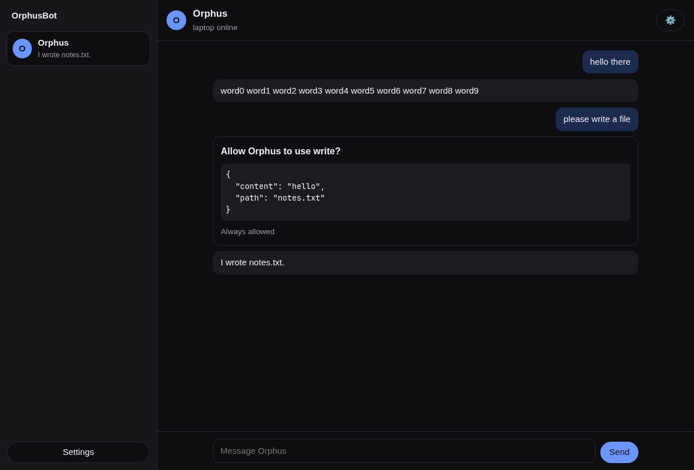

# OrphusBot

**Bots that work on your tasks, on your own machines, with your own AI subscriptions.**

OrphusBot is an open-source, self-hosted bot service. You hand it a task from the web, your desktop, your Android phone or a one-button wearable, and named bots carry it out on real computers using the [Orphus](https://github.com/kelvincushman/orphus) agent harness and the Claude and ChatGPT subscriptions you already pay for. A fast decision model routes every task and checks every risky step, and every decision it makes is recorded so you can see it and correct it.

> **Status: early development.** M0 and most of M1 work: a message from the browser streams a reply from Orphus on a node; runs survive a node dropping; risky tool calls wait for your approval; you sign in with a passkey; each machine enrols with its own key; a Leptos web UI in the Rakazo layout ties it together, and a Linux desktop app opens it in its own window. You can make several bots, each with its own instructions, model and fenced container, and watch a bot's screen and take over. Everything else is designed but not built yet (see [Roadmap](#roadmap)). To run it, see [docs/DEVELOPMENT.md](docs/DEVELOPMENT.md); to put it on your own network with HTTPS, [docs/DEPLOY.md](docs/DEPLOY.md). Issues and design feedback are welcome.



---

## Why

- **Your agent only works while you're at a terminal.** OrphusBot keeps bots running on an always-on machine, takes tasks from your phone or wrist, and nudges you only when it needs you.
- **Hosted bot products hold your credentials and data.** Here, model subscription tokens never leave your own machines, never enter a bot's sandbox and never reach the server's database.
- **Agent decisions are usually invisible.** Which bot answered, which model ran, why it didn't ask first: OrphusBot makes all of these one explicit decision layer with receipts, and learns from your corrections.
- **Most tools are hard on attention.** OrphusBot is designed first for neurodivergent people (ADHD in particular): calm digests, gentle nudges, time-blindness reminders, and capture of the things you said you'd do. It works for everyone.

## What it does

| Feature | In short |
|---|---|
| **Bots with computers** | Each bot gets its own isolated container on your machines (laptop, GPU box), reached privately over [NetBird](https://netbird.io). When your machines are busy or offline, or the work is untrusted, it runs in an [E2B](https://e2b.dev) sandbox instead. Watch any bot's screen live and take over from any device. |
| **System 1 / System 2** | [Laya](https://github.com/NandhaKishorM/laya), a fast "Jev-family" decision model, answers typed questions in milliseconds: which bot, which subscription, how urgent, act now or ask you, local or E2B, approve this step or not. Orphus agents do the slow, deliberate work. |
| **Safe by default** | Irreversible actions (send, pay, delete, merge, publish) always need a rule you set or a tap from you. The fast model can route, defer or deny, but never approve those. |
| **Receipts and learning** | Every decision is stored with its confidence and linked to what happened next. Your approvals, overrides and reassignments become labels to recalibrate and fine-tune the model, applied only when you say so, with rollback. |
| **Wearable, duplex** | The [wearable](wearable/README.md)'s button sends a spoken task to the bots. Bots answer through its light and vibration (no speaker, by design), and you answer back with a tap, a double tap or your voice. |
| **Ambient capture** | Optional hands-free mode turns conversation into proposed to-dos, appointments and follow-ups that you accept with one tap. No audio is stored; transcripts are deleted after 7 days. Off by default. |
| **Everywhere** | One Rust UI for the web, a desktop app and an Android app, kept in sync live. Push notifications through self-hosted ntfy; no Google account needed. |

## How it fits together

```
 Wearable ──BLE──► Android phone ──┐
 Browser / Desktop / Android app ──┼──► orphusbot-server (Rust, on an always-on box)
                                   │      tasks · runs · approvals · decisions · scheduler
                                   │      Postgres · laya-serve · ntfy
                                   │            │
                                   │            ├──► orphusbot-node (Rust) on each of your machines
                                   │            │      runs Orphus engines + one container per bot
                                   │            └──► E2B (overflow and untrusted work)
                                   └── everything over a private NetBird network
```

- **orphusbot-server** keeps everything that must survive a crash: tasks, runs, the event log, approvals, the side-effect ledger, schedules and decision receipts.
- **orphusbot-node** runs on each of your machines. It supervises `orphus --mode rpc` engines (where your subscription logins live) and the bots' containers.
- **orphusbot-bridge** is a tiny Orphus extension that sends each bot's tool calls into its own computer and asks the server before anything risky.
- **The UI** is written in Rust with Leptos and shipped through Tauri 2.

Full detail: [docs/DESIGN.md](docs/DESIGN.md).

## Roadmap

| Milestone | Delivers |
|---|---|
| **M0 Skeleton** ✅ | A message from the browser streams a reply from Orphus on your laptop |
| **M1 Durable runs** | Approvals, crash recovery, desktop app |
| **M2 Computers** | Per-bot containers, live screen, takeover, GPU-box node |
| **M3 System 1 + wearable** | Laya triage and approvals, tickets, routines, wearable tasks with the full duplex loop |
| **M4 Reach + capture** | E2B overflow, Android app, push, ambient capture |
| **M5 Learning** | Calibration, apply and rollback, in-process Laya |
| **M6 Breadth** | MCP integrations, artifacts, secrets |

## Documentation

| Document | What it covers |
|---|---|
| [docs/README.md](docs/README.md) | Documentation index |
| [docs/PRD.md](docs/PRD.md) | Product requirements: goals, requirements by area, user journeys, milestones, open questions |
| [docs/DESIGN.md](docs/DESIGN.md) | Design: components, run loop, decision layer, computers, wearable duplex habitat, capture, security, testing, deployment |
| [docs/DEVELOPMENT.md](docs/DEVELOPMENT.md) | Building, running and testing it locally |
| [docs/DEPLOY.md](docs/DEPLOY.md) | Running the server over NetBird with HTTPS and passkeys |
| [docs/DECISIONS.md](docs/DECISIONS.md) | Decision log: what was decided, when and why |
| [docs/research/rakazo-architecture.md](docs/research/rakazo-architecture.md) | The study of Rakazo that informed the design |
| [wearable/README.md](wearable/README.md) | The wearable: firmware, companion app, hardware, device channel, its own docs |
| [CONTRIBUTING.md](CONTRIBUTING.md) | How to contribute: workflow, documentation rule, ponytail, Rust practices |
| [AGENTS.md](AGENTS.md) | Rules for AI coding agents and reviewers working in this repo |
| [SECURITY.md](SECURITY.md) | Reporting vulnerabilities |
| [CHANGELOG.md](CHANGELOG.md) | What changed, per release |

## Contributing

Read [CONTRIBUTING.md](CONTRIBUTING.md) first. In short:

- Every change goes through a pull request, reviewed by [CodeRabbit](https://coderabbit.ai) and the maintainer.
- **Documentation is part of the change.** A PR that changes behaviour updates the docs and the changelog in the same PR; CI checks this.
- We follow the **[ponytail](https://github.com/DietrichGebert/ponytail) method**: reuse before you build, the smallest change that works, no speculative abstractions, and never cut validation, error handling, security or accessibility.

## Privacy

- No telemetry.
- Model subscription tokens stay on your machines.
- Data leaves your machines only to the model providers, E2B (when a task is placed there) and integrations you connect.
- The wearable's capture light is always on while it listens, and cannot be turned off.

Personal data (decision receipts, labels, transcripts) and any model fine-tuned on it are never committed to this repository.

## Acknowledgements

- [Orphus](https://github.com/kelvincushman/orphus): the agent harness OrphusBot drives.
- [Laya](https://github.com/NandhaKishorM/laya) by Nandha Kishor M (Apache-2.0): the System 1 decision engine.
- [Rakazo](https://github.com/elie222/rakazo) by Elie Steinbock (Apache-2.0): studied for its architecture. No Rakazo code is used.
- [ponytail](https://github.com/DietrichGebert/ponytail) by Dietrich Gebert (MIT): the engineering method.

## Licence

[MIT](LICENSE) © 2026 Kelvin Lee. Third-party components keep their own licences; see the acknowledgements above and each component's notice.
