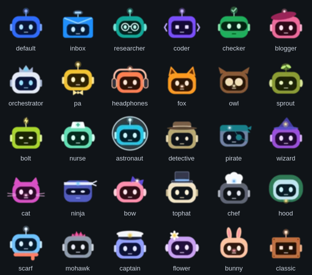

# Bot face

The animated face each bot has in the OrphusBot app and the Omarchy bar panel, made with the [Rive CLI](https://rive.app/docs/cli/overview) (no account needed).


States, left to right: 0 idle, 1 thinking, 2 working, 3 needs you, 4 done. The app sets the state machine `Bot`'s number input `state` (docs/DESIGN.md, M7.4).

## Styles

There are 30 face styles to pick from, all from `gen.py` and listed in `styles.txt` (`python3 gen.py --list` writes it; the app and the scripts read it). The first eight belong to the built-in bots; the rest form a library any bot can use. All share the same contract (artboard `Avatar`, state machine `Bot`, input `state`). In state 3 every style turns red with an amber light, so "needs you" looks the same everywhere. A bot without a style of its own (one you create) gets `default`.



[styles.png](styles.png) shows every style (rows, in `styles.txt` order) in each state 0-4 (columns).

| Style | Colour | Look |
|---|---|---|
| `default` | blue | ball antenna, side ears |
| `inbox` | azure | envelope head with a folded flap, mail-slot antenna, no ears |
| `researcher` | teal | round glasses, round ears |
| `coder` | violet | `< >` bracket ears (they are its light), square pixel eyes, square LED antenna |
| `checker` | green | wide visor, check-mark antenna |
| `blogger` | pink | beret whose tip is its light, no antenna |
| `pa` | gold | bow tie |
| `orchestrator` | silver | the main bot: deep navy face, three-point crown whose centre jewel is its light, no antenna |
| `headphones` | coral | headband with an LED on top, big ear cups |
| `fox` | orange | tall pointed ears with dark insides, light nose |
| `owl` | chocolate | ear tufts, big cream eye discs, beak |
| `sprout` | olive | two-leaf sprout growing from the head |
| `bolt` | lime | lightning-bolt antenna, slim eyes |
| `nurse` | mint | white cap with a cross |
| `astronaut` | cyan | glass bubble helmet, ball antenna |
| `detective` | khaki | brown fedora with a light band |
| `pirate` | slate | teal bandana with a knot, eye patch |
| `wizard` | plum | pointed indigo hat with a star |
| `cat` | magenta | cat ears, whiskers, pink nose |
| `ninja` | indigo | narrow eye-slit face, white headband with tails |
| `bow` | rose | big indigo bow on top |
| `tophat` | cream | dark top hat with a blue band |
| `chef` | charcoal | white chef's toque |
| `hood` | ice | green hood around the head, clasp below |
| `scarf` | sky | coral scarf with a tail, ball antenna |
| `mohawk` | steel | hot-pink spiky crest |
| `captain` | periwinkle | white captain's cap with a black visor and a badge |
| `flower` | lilac | white daisy on one side |
| `bunny` | peach | tall bunny ears, pink nose |
| `classic` | rust | square head with corner rivets, square eyes, square antenna |

## Changing it

Edit `gen.py`, then:

```sh
python3 gen.py default 0 > scene.rml    # scene.rml is the default style; `gen.py 0` means the same
rive . --verify && rive . --screenshot --advance=1   # build/bot-avatar.png
./build.sh                  # build/faces/<style>.riv for every style
./frames.sh build/webp      # build/webp/<style>-<state>.webp, for places that can't play Rive
./sheet.sh build/webp       # styles.png and styles-library.png
cp build/faces/*.riv ../../apps/orphusbot_app/assets/faces/
cp build/webp/*.webp ../../omarchy/kelvincushman.orphusbot/faces/
```

Don't use `rive push`: it uploads to a Rive account.
