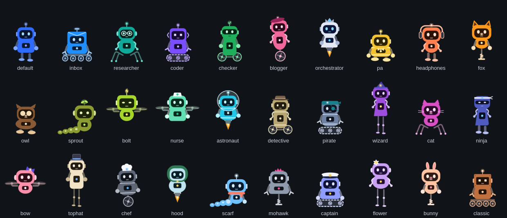
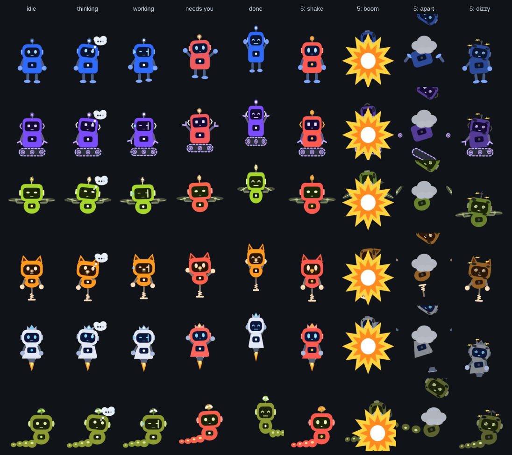

# Bot face and body

The animated face each bot has in the OrphusBot app and the Omarchy bar panel, and its full-body robot, made with the [Rive CLI](https://rive.app/docs/cli/overview) (no account needed).


States, left to right: 0 idle, 1 thinking, 2 working, 3 needs you, 4 done. The app sets the state machine `Bot`'s number input `state` (docs/DESIGN.md, M7.4).

Each style's `.riv` has two artboards, each with a state machine `Bot`:

| Artboard | Size | What | Inputs |
|---|---|---|---|
| `Avatar` (default) | 200x200 | the head only | `state` (Number, 0-5), `poke` (Trigger) |
| `Robot` | 200x260 | the head on a full body that walks, rolls, hops or flies | `state` (Number, 0-5), `poke` (Trigger) |

- **State 5, failed: self-destruct.** On `Avatar` the head shakes and flashes red, pops with a puff of smoke, and is left singed with spiral eyes and a dead light, swaying dizzily (1.2 s, then a 2 s loop). On `Robot` it shakes and flashes red (0.7 s), goes boom, flies apart (head up and spinning, arms, wheels and legs out), falls back together crooked (landed at 2.2 s), and sits singed and dizzy with spiral eyes and stars circling (the sequence is 2.8 s, then a 2 s loop). It stays dizzy until `state` changes. States 0-4 on `Avatar` look exactly as before.
- **`poke`** plays a reaction of about a second over whatever state is showing, then the state carries on. `Avatar` boings with wide eyes; `Robot` reacts to suit how it moves: legs and pogo boing, wheels and tracks pop a wheelie, drones and jets do a barrel roll, the snake giggles. Tapping either artboard fires `poke` too (a listener on a clear hit area).





The body is data: `BODIES` in `gen.py` gives each style a locomotion, a body shape, a size and arms.

| Locomotion | Idle | Styles |
|---|---|---|
| two legs | shifts its weight | default, headphones, ninja |
| chunky stubby feet | shifts its weight | pa, owl |
| long stilt legs | shifts its weight | wizard, tophat, flower |
| four spider legs | legs twitch | researcher, cat |
| one big wheel | rocks and balances | blogger, chef |
| two wheels | rocks back and forth | checker, detective |
| four wheels | rocks back and forth | inbox, classic |
| tank tracks | treads creep | coder, pirate, captain |
| drone rotors | rotors spin, hovers | bolt, nurse, bow |
| pogo spring | bounces | fox, mohawk, bunny |
| hover jet | flame flickers, hovers | orchestrator, astronaut, hood |
| snake segments | segments ripple | sprout, scarf |

Bodies are box, barrel, egg, round or triangle, in small, squat, medium or tall, with mitts, claws, noodle arms or none. Thinking adds a head tilt and a thought bubble; working, swinging arms, a sweat drop and faster wheels or rotors; needs you, red with waving arms and jumps; done, a jump with a spin and a wiggle.

## Styles

There are 30 face styles to pick from, all from `gen.py` and listed in `styles.txt` (`python3 gen.py --list` writes it; the app and the scripts read it). The first eight belong to the built-in bots; the rest form a library any bot can use. All share the same contract (artboard `Avatar`, state machine `Bot`, input `state`). In state 3 every style turns red with an amber light, so "needs you" looks the same everywhere. A bot without a style of its own (one you create) gets `default`.


[styles.png](styles.png) shows every style (rows, in `styles.txt` order) in each state 0-4 (columns).

| Style | Colour | Look |
|---|---|---|
| `default` | blue | ball antenna, side ears |
| `inbox` | azure | envelope head with a folded flap, mail-slot antenna, no ears |
| `researcher` | teal | round glasses, round ears |
| `coder` | violet | `< >` bracket ears (they are its light), square pixel eyes, square LED antenna |
| `checker` | green | wide visor, check-mark antenna |
| `blogger` | pink | beret whose tip is its light, no antenna |
| `pa` | gold | bow tie |
| `orchestrator` | silver | the main bot: deep navy face, three-point crown whose centre jewel is its light, no antenna |
| `headphones` | coral | headband with an LED on top, big ear cups |
| `fox` | orange | tall pointed ears with dark insides, light nose |
| `owl` | chocolate | ear tufts, big cream eye discs, beak |
| `sprout` | olive | two-leaf sprout growing from the head |
| `bolt` | lime | lightning-bolt antenna, slim eyes |
| `nurse` | mint | white cap with a cross |
| `astronaut` | cyan | glass bubble helmet, ball antenna |
| `detective` | khaki | brown fedora with a light band |
| `pirate` | slate | teal bandana with a knot, eye patch |
| `wizard` | plum | pointed indigo hat with a star |
| `cat` | magenta | cat ears, whiskers, pink nose |
| `ninja` | indigo | narrow eye-slit face, white headband with tails |
| `bow` | rose | big indigo bow on top |
| `tophat` | cream | dark top hat with a blue band |
| `chef` | charcoal | white chef's toque |
| `hood` | ice | green hood around the head, clasp below |
| `scarf` | sky | coral scarf with a tail, ball antenna |
| `mohawk` | steel | hot-pink spiky crest |
| `captain` | periwinkle | white captain's cap with a black visor and a badge |
| `flower` | lilac | white daisy on one side |
| `bunny` | peach | tall bunny ears, pink nose |
| `classic` | rust | square head with corner rivets, square eyes, square antenna |

## Changing it

Edit `gen.py`, then:

```sh
python3 gen.py default 0 > scene.rml    # scene.rml is the default style; `gen.py 0` means the same
rive . --verify && rive . --screenshot --advance=1   # build/bot-avatar.png
./build.sh                  # build/faces/<style>.riv for every style: verified, inspected, under 25 KB
./frames.sh build/webp      # build/webp/<style>-<state>.webp, for places that can't play Rive
./sheet.sh build/webp       # styles.png and styles-library.png
./bodies.sh                 # bodies.png and bodies-states.png (the Robot artboard)
cp build/faces/*.riv ../../apps/orphusbot_app/assets/faces/
cp build/webp/*.webp ../../omarchy/kelvincushman.orphusbot/faces/
```

To look at the robot: `rive . --artboard=Robot --screenshot --advance=30`. A tap is `--pointer=click@100,150`.

Don't use `rive push`: it uploads to a Rive account.
