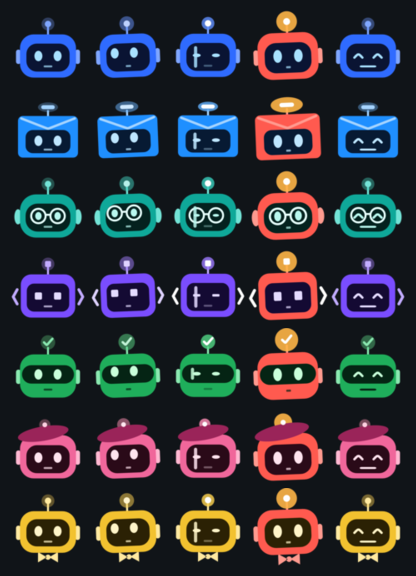

# Bot face

The animated face each bot has in the OrphusBot app and the Omarchy bar panel, made with the [Rive CLI](https://rive.app/docs/cli/overview) (no account needed).


States, left to right: 0 idle, 1 thinking, 2 working, 3 needs you, 4 done. The app sets the state machine `Bot`'s number input `state` (docs/DESIGN.md, M7.4).

## Styles

Each bot has its own face style, all from `gen.py` and all with the same contract (artboard `Avatar`, state machine `Bot`, input `state`). In state 3 every style turns red with an amber light, so "needs you" looks the same everywhere. A bot without a style of its own (one you create) gets `default`.



| Style | Colour | Look |
|---|---|---|
| `default` | blue | ball antenna, side ears |
| `inbox` | azure | envelope head with a folded flap, mail-slot antenna, no ears |
| `researcher` | teal | round glasses, round ears |
| `coder` | violet | `< >` bracket ears (they are its light), square pixel eyes, square LED antenna |
| `checker` | green | wide visor, check-mark antenna |
| `blogger` | pink | beret whose tip is its light, no antenna |
| `pa` | gold | bow tie |

## Changing it

Edit `gen.py`, then:

```sh
python3 gen.py default 0 > scene.rml    # scene.rml is the default style; `gen.py 0` means the same
rive . --verify && rive . --screenshot --advance=1   # build/bot-avatar.png
./build.sh                  # build/faces/<style>.riv for every style
./frames.sh build/webp      # build/webp/<style>-<state>.webp, for places that can't play Rive
./sheet.sh build/webp       # styles.png
cp build/faces/*.riv ../../apps/orphusbot_app/assets/faces/
cp build/webp/*.webp ../../omarchy/kelvincushman.orphusbot/faces/
```

Don't use `rive push`: it uploads to a Rive account.
