# Rakazo UX spec, captured live (for the OrphusBot rebuild)

| | |
|---|---|
| Date | 2026-10-20 |
| Rakazo version | Published images, tag `edge`, built from `main` at about `38b8e713` (the commit studied in [rakazo-gap-2026-10-20.md](rakazo-gap-2026-10-20.md)) |
| Instance | Fresh self-hosted install on the GPU box, reached from the laptop at `http://127.0.0.1:5173` through an SSH tunnel |
| Method | A headless Chromium on the laptop (own profile, CDP on port 9335) driven step by step; REA (`list_browser_targets`, `inspect_web_page` with accessibility text) used to read DOM and accessibility trees; a small CDP script did clicks, typing, screenshots and `getComputedStyle` reads. Colours below are the app's own CSS custom properties, read from its stylesheet; sizes are measured bounding boxes. Viewports: 1440 × 900 desktop, 390 × 844 mobile (touch emulation), dark (the browser default here) plus a light pass |
| Account | Throwaway `capture@example.test`; no personal data in any image |
| Screenshots | 137 PNGs in [rakazo-ux/](rakazo-ux/), about 11 MB in total. 01–98 are from the first pass (model unreachable); 99–141 are from the second pass after the box's firewall was opened for Rakazo's Docker network |
| Companion docs | [rakazo-gap-2026-10-20.md](rakazo-gap-2026-10-20.md) (feature gap, read from source), [rakazo-architecture.md](rakazo-architecture.md) |

**Licence note.** Rakazo is Apache-2.0. This document describes behaviour, layout and wording so that we can rebuild the experience in our own code, in our own words, on our own stack (Flutter app, Leptos web UI, Omarchy panel). We copy no code, CSS or assets. Our product carries no Rakazo name, logo, mascot, wordmark or bot-shape artwork; the screenshots here are research records and are never shipped. Quoted UI strings are quoted to show tone and length; we write our own copy.

**What could not be captured live, and why.** After the firewall fix the model answered, so streaming, tool activity, Markdown with a table, code and Mermaid, the question card, the secret card, the instruction-proposal card (Apply and Dismiss), the MCP-connect card, an archive card, bot-made child bots and bot-to-bot messages were all seen live. Still not seen:

- **The generic approval card** with Allow once / Always allow / Deny. On this install nothing asked: Rakazo runs consequential calls without asking unless a Confirmations rule or auto-review flags them, and the bot had no connector tools (no email, no purchases) for the two preset rules to catch. Spawning, archiving and retitling bots, adding an MCP server and an authenticated HTTP call all ran without a card. The instruction proposal does go through the same approval path (its resolved state reads "Allowed once"), so §5.1 describes the card family from that plus the source study.
- **Message edit and retry.** Rakazo has neither. The message menu is Reply and Copy only, on both owner and bot messages ([138](rakazo-ux/138-bot-message-more-menu.png)); a failed run says "Try again" but offers no retry button.
- **Ticket board** (feature flag off; `/app/board` redirects to the chat), **hold-to-talk and calls** (need a voice provider key; the mic never appears without one), the **noVNC picture** in the full-window computer (stayed on its placeholder), the **terminal** (removed upstream in #1588), **Teach a task** recording (not started, to keep load off the box), **OAuth catalogues** (no Composio or Pipedream keys, on purpose), and the Electron and Expo native apps (web only).

**Clean-up done on the account.** The routine "Morning papers" was deleted; both computers show "suspended / Computer is asleep" (there is no Stop button; computers sleep on their own); the test MCP server "Example Docs" was deleted; the dummy credential `example-api-key` was removed. Left in place: the bots Chief, Researcher and Scribe (a child of Chief), the group Desk, two small test artifacts, and Chief's Fleet management switch (on) and its one-line instruction "Use British English spelling."

---

## Contents

1. [Navigation map](#1-navigation-map)
2. [Model connection](#2-model-connection)
3. [Screens](#3-screens)
4. [Visual language](#4-visual-language)
5. [Interaction patterns](#5-interaction-patterns)
6. [Mapping to OrphusBot screens](#6-mapping-to-orphusbot-screens)

---

## 1. Navigation map

```
Logged out
  /                      Welcome ──► Sign up ──► /onboarding
  /sign-in  /sign-up  /forgot-password  /reset-password?token=…
                                   (signed-in users are redirected to /app)
Onboarding  /onboarding
  Connect a model ──► Server integrations (Skip) ──► /app/<Chief> with a choice card

Shell  /app/<botId>   /app/g/<groupId>
  ┌─ Sidebar (316 px) ───────────┬─ Chat ──────────────────────┬─ Side panel (≈ 380 px, optional) ─┐
  │ [bell Activity] [⊟ Minimize] [+]                            │ header: avatar + name ► Bot settings│ Bot settings ◄► Computer│
  │ Search  (Activity mode: Search runs + Filters)              │ [monitor] ► Computer panel           │ Computer ► Routine editor│
  │ PERSONAL ▾ …  (space header: Settings, Rename space)        │ transcript                          │ New bot / New group      │
  │   rows: avatar, name, time, title chip, preview / Working…  │ error alert (above composer)        │ Group settings           │
  │   right-click: Pin, Move to ▸, Mark as Unread, Edit Profile, │ composer                            │                          │
  │     Duplicate, Clear conversation, Archive, Delete          │                                     │                          │
  │ footer: [avatar ▸ account menu] [Connect apps pill]         │                                     │                          │
  └─────────────────────────────────────────────────────────────┴─────────────────────────────────────┴──────────────────────────┘
  + popover: To: search · Create new Bot · (bots) · Create new Group (i) · Create new Space (i)
  Account menu: Usage · Get the mobile app · Docs · Artifacts · Settings · Log out
  Ctrl+K: Switch bot palette (Ctrl+1…9 per bot)

Overlays (1080 × 760 dialogs)
  Settings: General · Models · Memory · Voice · Confirmations · Usage · Updates
  Integrations (Connect apps): Browse MCP servers · Advanced ▸ Add MCP server / OpenAPI / GraphQL / Executor / Treg · Manage MCP servers
Full-window views
  Computer: Take control / Release control · Teach a task · ⋯ (Recover, Reset, Update) · Close
  /app/artifacts (cards | list, Filters) ──► /app/artifacts/<id> (index + preview)
Mobile (< 768 px)
  Sidebar becomes a drawer (hamburger "Open navigation", scrim); side panels and settings cover the screen; settings nav becomes a top tab strip
```

Routes observed: `/`, `/sign-in`, `/sign-up`, `/forgot-password`, `/reset-password`, `/onboarding`, `/app/<botId>`, `/app/g/<groupId>`, `/app/artifacts`, `/app/artifacts/<id>`. `/app/board` redirected to the last chat (flag off).

---

## 2. Model connection

- Rakazo **does** have a generic option: the provider list ends with **OpenAI-compatible**, which asks for a server URL, a model id, an optional API key, and an Advanced block (Supports thinking, Maximum output tokens default 4096, Context limit default 32768, Supports images).
- Configured: URL `http://host.docker.internal:8000/v1`, model `qwen3.8-27b-abl`, no API key (the optional key field lost its value on re-render), Context limit raised to 131072 and Maximum output tokens to 8192 ([34](rakazo-ux/34-settings-models-advanced.png)).
- **First pass: failed.** "Find models" returned "Model server probe timed out. You can still Connect with an explicit model id." Runs failed with "Your model provider took too long to respond. Try again." (Details: "Request timed out.") or, at the default 32 k context limit, "The model provider returned an error." (Details: "Required context exceeds the model context budget"). Cause: the box's firewall blocked Rakazo's Docker network from port 8000.
- **Second pass: works.** After a rule for 172.19.0.0/16 to port 8000 was added on the box, "Find models" fills the Model select with `qwen3.8-27b-abl` and no error ([99](rakazo-ux/99-settings-models-found.png)). The first token of the first run took about two minutes on the busy box; later replies began within seconds.
- The 32 k default context limit is too small for Rakazo's own system prompt and tool list; a self-hosted model needs it raised before the first run.
- The onboarding choice card is answered by Rakazo itself without a model ([80](rakazo-ux/80-choice-card-answered.png)).

---

## 3. Screens

Each section: screenshot(s), purpose, layout, controls, key copy, states, mobile. Coordinates are at 1440 × 900.

### 3.1 Welcome

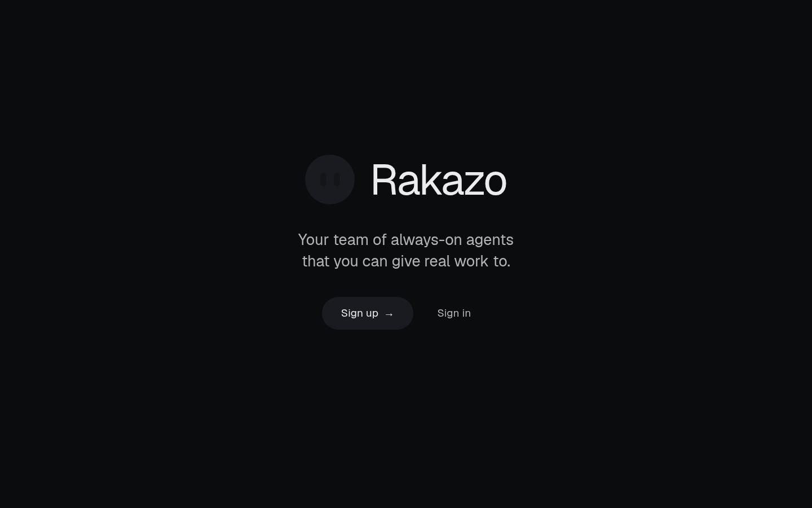

- **Purpose:** public landing for a self-hosted instance.
- **Layout:** one centred column on the page background. Mascot disc (88 px) beside a 96 px wordmark; a two-line tagline in muted grey at about 26 px; a row with a filled pill button and a text link.
- **Controls:** `Sign up →` (pill, 163 × 59), `Sign in` (link styled as a ghost pill).
- **Copy:** "Your team of always-on agents / that you can give real work to."
- **Mobile:** [92](rakazo-ux/92-mobile-welcome.png). Same column; the tagline wraps to four lines; buttons stay side by side.

### 3.2 Sign up, sign in, forgot and reset password

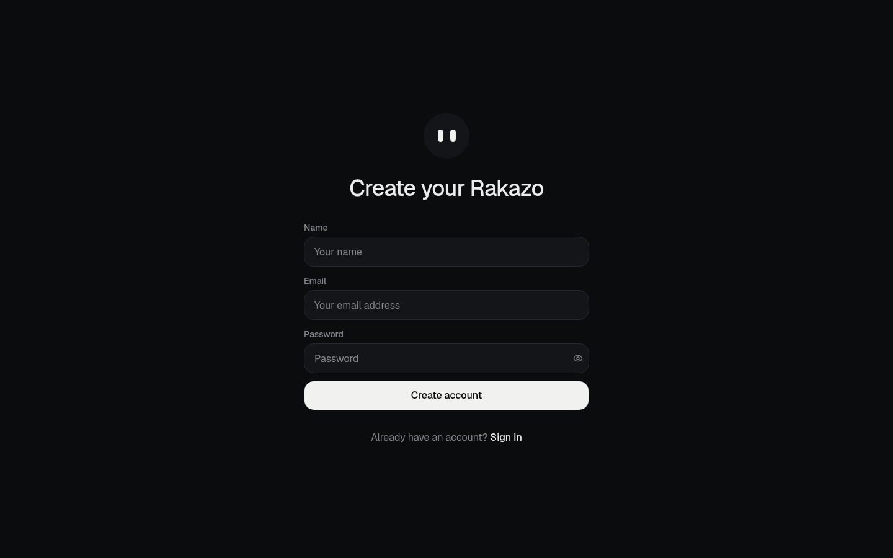

Also: [03 sign in](rakazo-ux/03-sign-in.png), [04 forgot password](rakazo-ux/04-forgot-password.png), [05 reset password](rakazo-ux/05-reset-password-invalid.png), [06 sign-in error](rakazo-ux/06-sign-in-error.png), [93 mobile sign up](rakazo-ux/93-mobile-sign-up.png).

- **Layout:** a 460 px centred column: mascot (72 px) above a large heading, then label-above-field inputs (48 px tall, 12 px radius), a full-width primary button (48 px, white on dark), and a one-line footer link.
- **Controls and copy:**
  - Sign up: heading "Create your Rakazo"; Name ("Your name"), Email ("Your email address"), Password (with an eye `Show password` button inside the field); `Create account`; "Already have an account? Sign in".
  - Sign in: "Sign in to Rakazo"; Email, Password; `Continue with email`; "Don't have an account? Sign up".
  - Forgot: "Reset your password"; Email; `Send reset link`; "Back to sign in".
  - Reset: "Choose a new password"; New password, Confirm password; `Reset password`; "Back to sign in". An invalid token is not flagged until submit.
- **States:** wrong credentials show "Invalid email or password" in red between the fields and the button; the button stays enabled.
- **Mobile:** fields go edge to edge with a 24 px gutter; nothing else changes.

### 3.3 Onboarding: connect a model

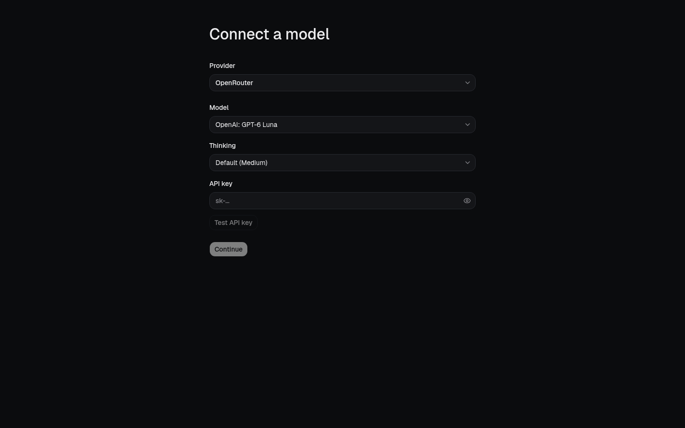

Also: [08 provider list](rakazo-ux/08-onboarding-provider-list.png), [09 OpenAI-compatible](rakazo-ux/09-onboarding-openai-compatible.png), [10 probe error](rakazo-ux/10-onboarding-find-models.png), [11 Advanced open](rakazo-ux/11-onboarding-advanced.png).

- **Purpose:** first screen after sign-up when the space has no model.
- **Layout:** a 560 px column, top-aligned (heading at y 70), no stepper and no progress. 36 px selects with chevrons, labels above.
- **Controls (preset provider):** Provider select (default OpenRouter), Model select (default a popular model), Thinking select ("Default (Medium)"), API key (password field, placeholder `sk-…`, eye button), `Test API key` (outline, disabled until a key is typed), `Continue` (primary, disabled until valid).
- **Provider list:** 42 providers, alphabetical-ish with subscriptions inline (ChatGPT, GitHub Copilot) and **OpenAI-compatible** last.
- **Controls (OpenAI-compatible):** Server URL (placeholder `http://127.0.0.1:8000/v1`), `Find models`, Model (free text `exact-model-id`, becomes a select "Models from server" once found), `Advanced ⌄` (Supports thinking checkbox, Maximum output tokens and Context limit as small 96 px number fields right-aligned on their rows, Supports images checkbox), `▸ API key` disclosure ("Optional"), `Continue`.
- **States:** `Find models` → `Finding…` (disabled) → either a model select or a two-line error: red "Model server probe timed out. You can still Connect with an explicit model id." and grey "Check the server URL and network, then test again." The error clears as soon as the user types.
- **Mobile:** not captured (needs a fresh account); the column is fluid and would follow the auth pages.

### 3.4 Onboarding: server integrations

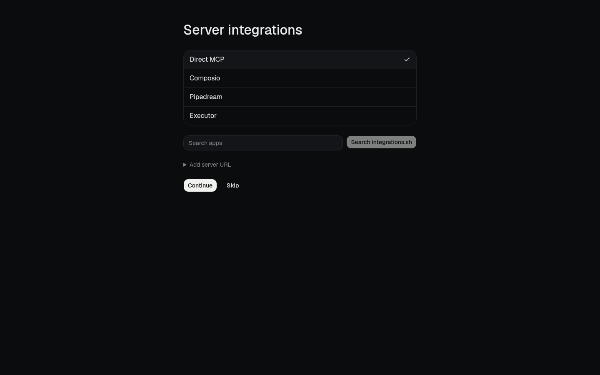

Also: [13 Composio selected](rakazo-ux/13-onboarding-integrations-composio.png).

- **Purpose:** the owner picks how apps are connected for the whole server.
- **Layout:** heading, then a bordered list of four full-width options (45 px rows, a check on the selected one), then the selected option's form, then `Continue` and `Skip`.
- **Options:** Direct MCP (default; "Search apps" field with `Search integrations.sh`, `▸ Add server URL` with `https://example.com/mcp`), Composio (API key and a "Get credentials" link), Pipedream, Executor.
- **Copy:** heading only ("Server integrations"); no explanation text, in line with the "calm surface" rule.

### 3.5 First bot chat and the choice card

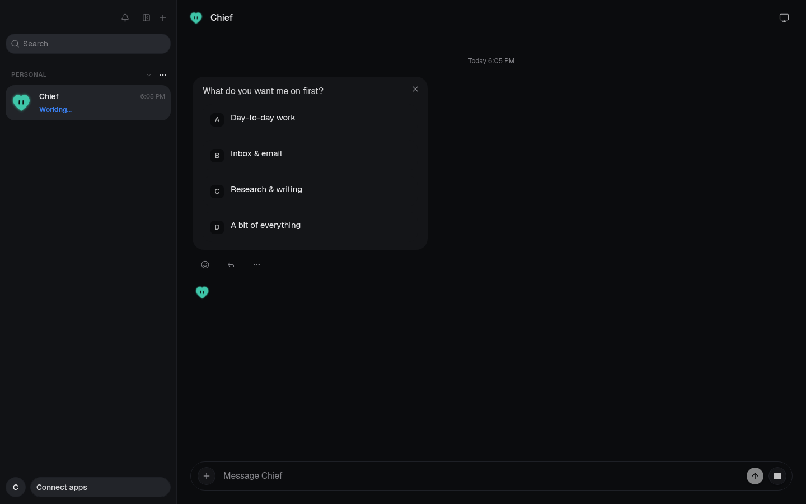

Also: [80 answered](rakazo-ux/80-choice-card-answered.png).

- **Purpose:** the first bot, "Chief", is created and greets the user with a choice card while its intro run starts.
- **Layout:** the full shell (see 3.7). The card is a 420 px rounded (20 px) panel on `--card`, with a question line, four rows each with a lettered square badge (A–D) and a label, and a close `×` ("Dismiss") top right.
- **Copy:** "What do you want me on first?" A Day-to-day work · B Inbox & email · C Research & writing · D A bit of everything.
- **States:** while the intro run is live, the sidebar row shows a blue "Working…" line and the transcript shows the bot's small avatar alone on a line (the "is working" marker; screen readers get "Chief is working"). After choosing, the card collapses to the chosen row with a check, and two scripted bot messages follow: "Got it. Slack, calendar, and email. I'll see what's already connected so I don't make you set something up twice." and "What would you like to work on first?"
- **Note:** every new bot gets the same card and an intro run whose prompt (visible in Activity) is "You were just created. In one reply, say what you understood your role to be from your title, description and instructions…".

### 3.6 Run error alert

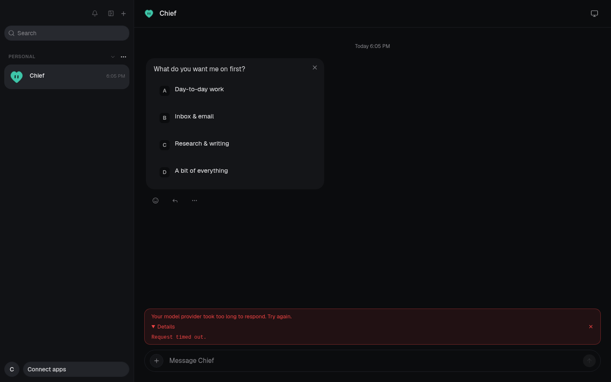

Also: [15 collapsed](rakazo-ux/15-run-error-timeout.png), [48 next to the computer panel](rakazo-ux/48-run-error-provider-timeout.png), [44 context-budget error](rakazo-ux/44-routine-daily.png).

- **Layout:** a full-width alert docked directly above the composer, red tinted fill, 1 px red border, 12 px radius. Line 1: a short sentence. Line 2: `▸ Details` disclosure; open, it shows the raw reason in monospace. A small `×` ("Dismiss error") on the right.
- **Copy seen:** "Your model provider took too long to respond. Try again." / "Request timed out."; "The model provider returned an error." / "Required context exceeds the model context budget".
- **States:** the alert belongs to the session; it is gone after navigating away and back. The failed run shows as "Failed" in Activity. Nothing is added to the transcript.

### 3.7 Shell: sidebar, header, transcript, composer

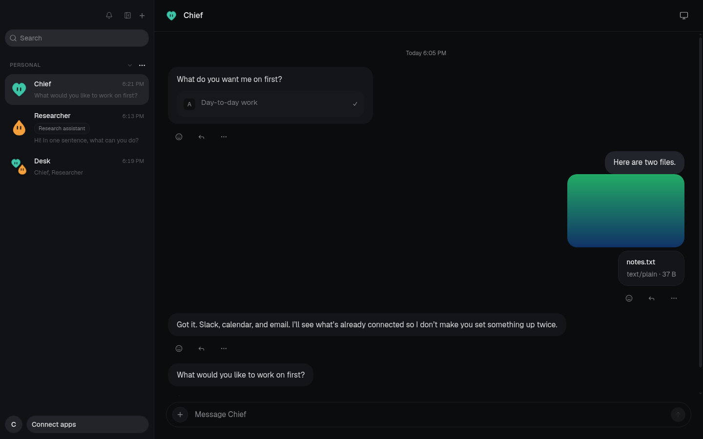

Also: [20 new bot working](rakazo-ux/20-new-bot-chat.png), [24 message sent while working](rakazo-ux/24-message-sent-while-working.png), [64 sidebar minimized](rakazo-ux/64-sidebar-minimized.png), [85 mobile chat](rakazo-ux/85-mobile-chat.png), [86 mobile drawer](rakazo-ux/86-mobile-drawer.png), [94 light](rakazo-ux/94-light-chat.png).

- **Regions:** sidebar 316 px on `--sidebar` with a 1 px right border, then the chat column. A thin invisible 8 px strip on the sidebar's edge is a "Hide bots" button.
- **Sidebar top row** (right-aligned, 28 px icon buttons): `Activity` (bell), `Minimize bots` (panel icon), `+`. Below: a 36 px pill search field "Search".
- **Section header:** "PERSONAL" in 11 px semibold uppercase muted, with a collapse chevron and a `⋯` "Actions for Personal" (menu: Settings, Rename space) ([57](rakazo-ux/57-section-actions.png)).
- **Roster row:** 295 px wide inside 10 px gutters, 16 px radius, 10 px padding. 38 px avatar; name 14 px medium; time 12 px muted, right-aligned; an optional title chip (small rounded tag, e.g. "Research assistant"); then either a muted one-line preview of the last message, or a blue "Working…" line. Selected row fill `--sidebar-accent`. Groups show two overlapping avatars and the member names as the preview.
- **Sidebar footer:** a 36 px round account button with the initial ("Account menu for `capture@example.test`") and a "Connect apps" pill filling the rest of the row.
- **Minimized:** the sidebar collapses, the header gains a `Show bots` button at its left ([64](rakazo-ux/64-sidebar-minimized.png)).
- **Chat header:** 65 px tall, 17 × 22 px padding, bottom border. Bot avatar and name (a button that opens Bot settings); right side `Agent computer` (monitor icon). Nothing else.
- **Transcript:** centred day separator ("Today 6:05 PM", 12 px muted). Bot messages left in `--card` bubbles (20 px radius, 12 × 18 px padding, 15.5 px text); owner messages right in `--chat-user` bubbles (same radius). Under each message a hover row: `React`, `Reply`, `More` (44 px hit targets, small icons). A round `Jump to latest` button (36 px) floats above the composer when scrolled up.
- **Composer:** a 52 px pill (26 px radius, 1 px border) spanning the column with 24 px side margins. Left `Attach file` (32 px round `+`), the textarea "Message <bot name>" (15.5 px), right `Send` (32 px round, arrow up; dimmed when empty, white when there is text) and, while a run is live, `Stop` (square). Focus draws a blue ring around the whole pill.
- **Mobile:** the sidebar becomes an off-canvas drawer opened by a hamburger ("Open navigation") at the header's left; the drawer is the full 316 px sidebar over a dark scrim. Transcript and composer go edge to edge with 16 px gutters; bubbles keep their shape; hover actions stay visible under every message.

### 3.8 The `+` popover and creating a bot

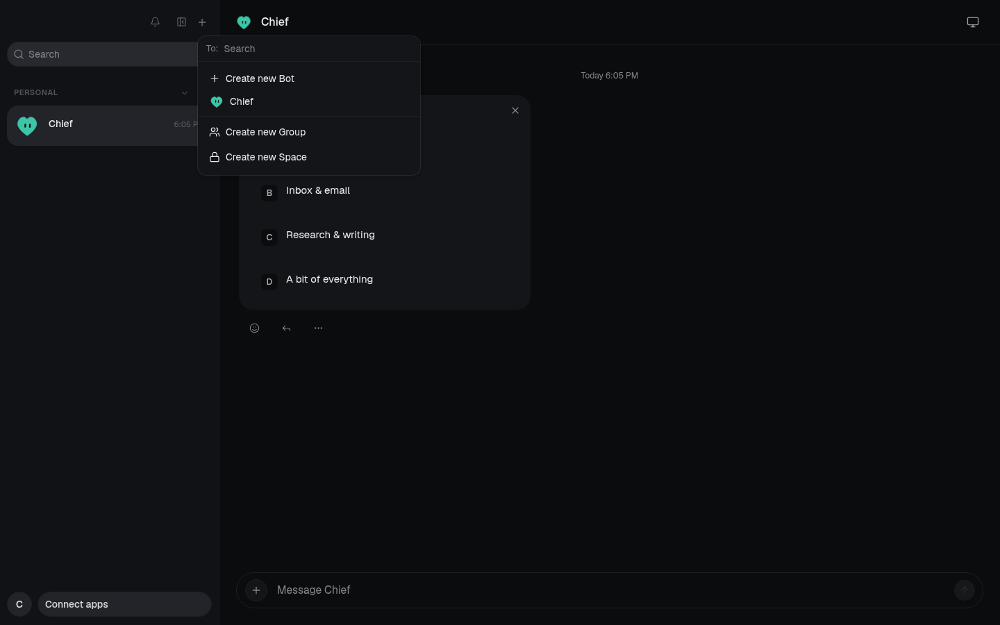

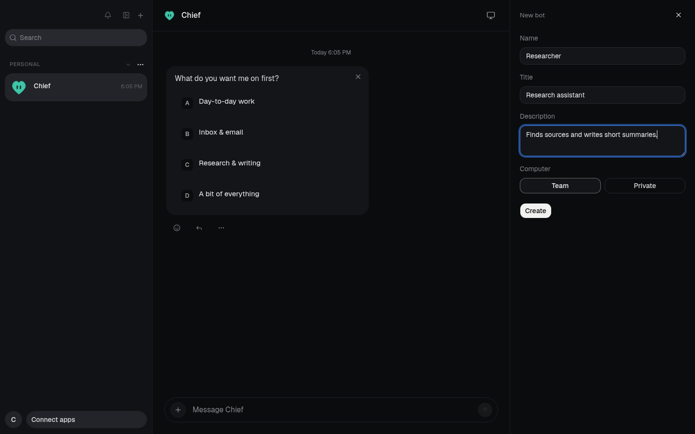

- **Popover:** anchored to `+`, 304 px. A "To:" search field, then options: `Create new Bot`, existing bots (to jump), `Create new Group` (with an `(i)` "About groups"), `Create new Space` (with "About spaces").
- **New bot panel** (side panel, 380 px, header "New bot" with `×` "Cancel new bot"): Name ("Name this bot"), Title ("Describe what this bot does"), Description textarea ("What this bot is for"), a two-way segmented control `Team` / `Private` (the bot's computer), `Create` (disabled until a name).
- **After Create:** the bot appears in the sidebar with "Working…", its chat opens, the same choice card appears and an intro run starts ([20](rakazo-ux/20-new-bot-chat.png)).

### 3.9 Bot settings and Avatar Studio

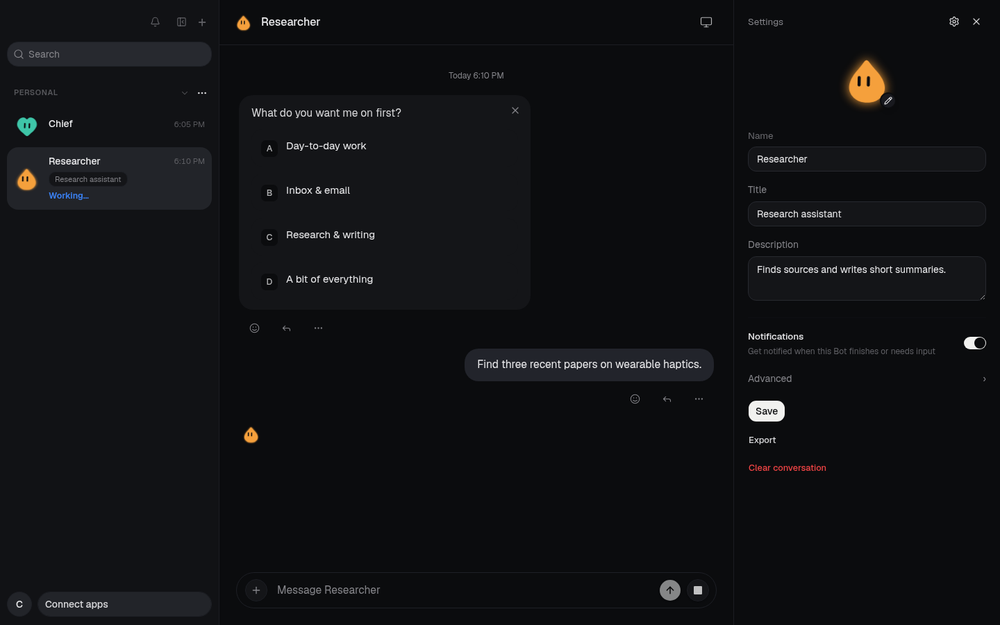

Also: [28 Avatar Studio](rakazo-ux/28-avatar-studio.png), [29 Advanced](rakazo-ux/29-bot-settings-advanced.png), [87 mobile](rakazo-ux/87-mobile-bot-settings.png), [95 light](rakazo-ux/95-light-bot-settings.png).

- **Layout:** right side panel, header "Settings" with `Show computer` (switch to the computer view) and `Close panel`. A 76 px avatar with a pencil badge ("Customize bot avatar"), then fields.
- **Basic controls:** Name, Title (placeholder "e.g. Hivenet Agent, Presales, Timesheets bot"), Description textarea; Notifications switch with the hint "Get notified when this Bot finishes or needs input"; `Advanced ›`; `Save` (small white pill); `Export` (text button); `Clear conversation` (red text button).
- **Advanced:** Instructions textarea; Computer `Team` / `Private`; Open work ("None yet", "Add item" field and `Add`); tabs `Memory` / `Shared skills` listing `MEMORY.md rev 1` with "Download as markdown"; Model select ("Space default (qwen3.8-27b-abl)") with a hint line naming the provider; switches "Read replies aloud" and "Fleet management" (hint: "Lets this bot organize, retune and schedule the bots it creates. You approve each change."); Disabled tools (monospace field `web_search`); Credentials ("Values are encrypted and never shown again.", empty state "No credentials saved for this bot.", `Add credential`).
- **Avatar Studio:** a 240 px popover over a blurred backdrop. Big preview; tabs `Bot` / `Upload`; `Reset`; "SHAPE" with `Default` and eight shapes (hex, wedge, squircle, tablet, pebble, blob, teardrop, cloud); "COLOR" with eleven swatches (white, violet, emerald, orange, cyan, blue, yellow, brown, red, pink, slate); `✓ Done`.
- **Mobile:** the panel covers the whole screen.

### 3.10 Message actions and reactions

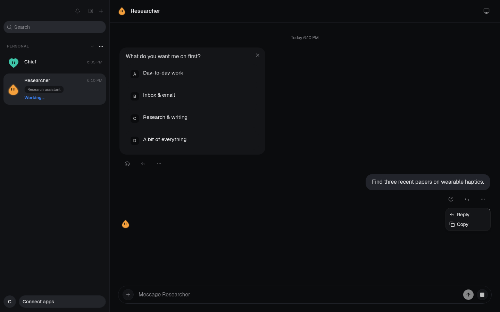

Also: [26 reaction picker](rakazo-ux/26-message-react-picker.png).

- `More` opens a small menu: Reply, Copy, on owner and bot messages alike ([138](rakazo-ux/138-bot-message-more-menu.png)). No Edit, Retry, Regenerate or Delete. (Quote and Speak exist in the source but did not appear here; Speak needs a voice provider.)
- `React` opens a one-row picker with six emoji: 👍 👎 ❤️ 😂 🎉 😮.

### 3.11 Composer: mentions, slash commands, attachments

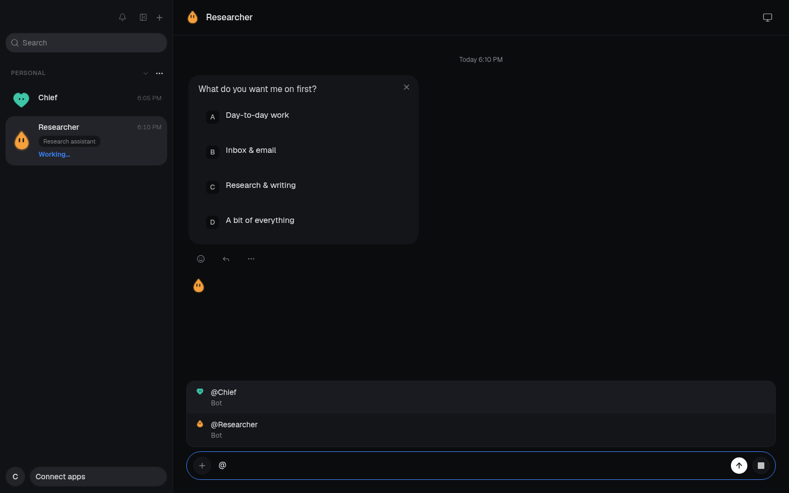

Also: [22 slash menu](rakazo-ux/22-composer-slash-menu.png), [23 typing while the bot works](rakazo-ux/23-composer-typed-while-working.png), [76 attachments pending](rakazo-ux/76-composer-attachments.png), [77 sent](rakazo-ux/77-message-with-attachments.png), [78 lightbox](rakazo-ux/78-image-lightbox.png).

- **`@`:** a full-width list docked above the composer, one 60 px row per bot ("@Chief", "@Researcher") with avatar and "Bot".
- **`/`:** the same docked list, with icon, title and an optional muted description: "Interrogate — Adversarial review of a diff/PR/plan. Review only; never applies fixes.", "Chat Settings", "Settings: General", "Settings: Usage".
- **Attachments:** accepted types are JPEG, PNG, WebP, GIF, MP3, WAV, OGG, MP4 audio and video, PDF, plain text, Markdown, CSV, HTML, JSON and ZIP, several at once. Pending files sit as chips above the composer (image chips show a thumbnail; others a paperclip) each with `×` "Remove <name>". Sent: images render as 240 × 150 rounded tiles under the bubble; other files as small cards "notes.txt / text/plain · 37 B". Clicking an image opens a centred lightbox on a blurred backdrop with `Close image preview`. Every attachment also lands in Artifacts.

### 3.12 Computer panel and full-window computer

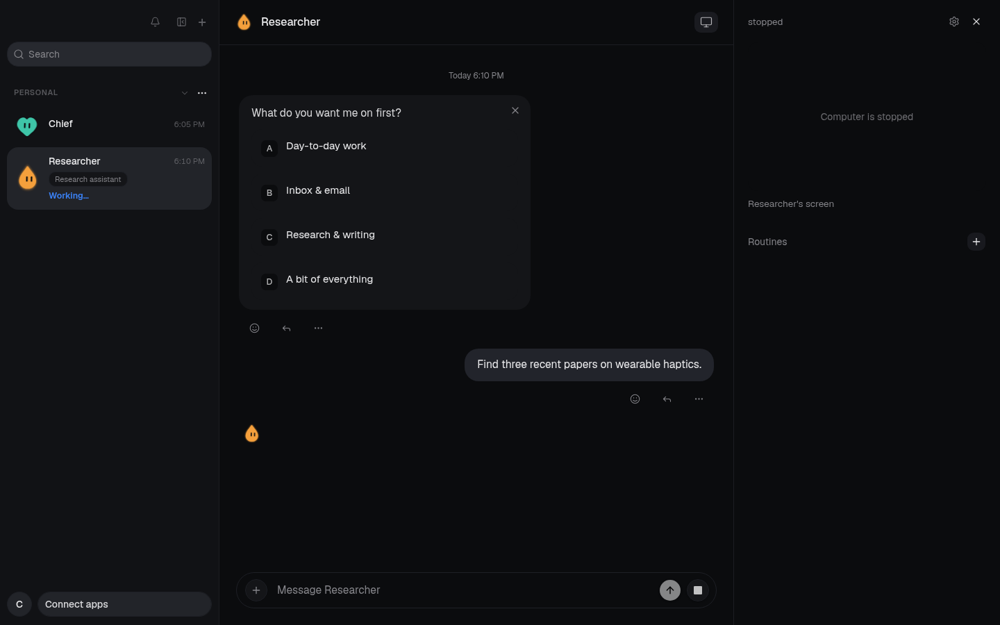

Also: [47 with a routine](rakazo-ux/47-computer-panel-with-routine.png), [96 light, running](rakazo-ux/96-light-computer-panel.png), [49 full window](rakazo-ux/49-computer-full-window.png), [50 maintenance menu](rakazo-ux/50-computer-more-menu.png), [51 take control](rakazo-ux/51-computer-take-control.png), [52 teach a task](rakazo-ux/52-teach-a-task.png), [88 mobile](rakazo-ux/88-mobile-computer-panel.png).

- **Side panel:** a status word top left ("stopped", "running"), `Show settings` and `Close panel`. A 16:10 preview tile (the whole tile is the `Open` button) with "Computer is stopped" or the live picture; caption "<Bot>'s screen". Then "Routines" with a `+` ("Create Routine") and rows "Morning papers / Every day at 9:00 AM".
- **Full window:** a 56 px top bar: avatar, "Team Computer"; right `Take control` (outline pill), `○ Teach a task`, `⋯` ("More computer actions"), `×` ("Close computer"). The body is the remote screen; here it stayed on the placeholder label "Team Computer".
- **Take control:** the button becomes `Release control` and a green pill "You have control" appears beside the title.
- **⋯ menu:** two-line items: "Recover computer — Recreate a computer that is not working.", "Reset computer — Restore the last saved workspace.", "Update computer — Save the workspace and install current software."
- **Teach a task:** a popover "What result will you demonstrate?" with a textarea (placeholder "Export this week's list from the CRM and drop it in the shared folder"), `Start recording` (disabled until text) and `Cancel`.
- **States:** opening the panel does not boot the computer; `Open` does (status changed from stopped to running). After idling it shows "suspended" and "Computer is asleep. Open it to wake." ([107](rakazo-ux/107-computer-asleep-panel.png)); there is no Stop button.

### 3.13 Routine editor

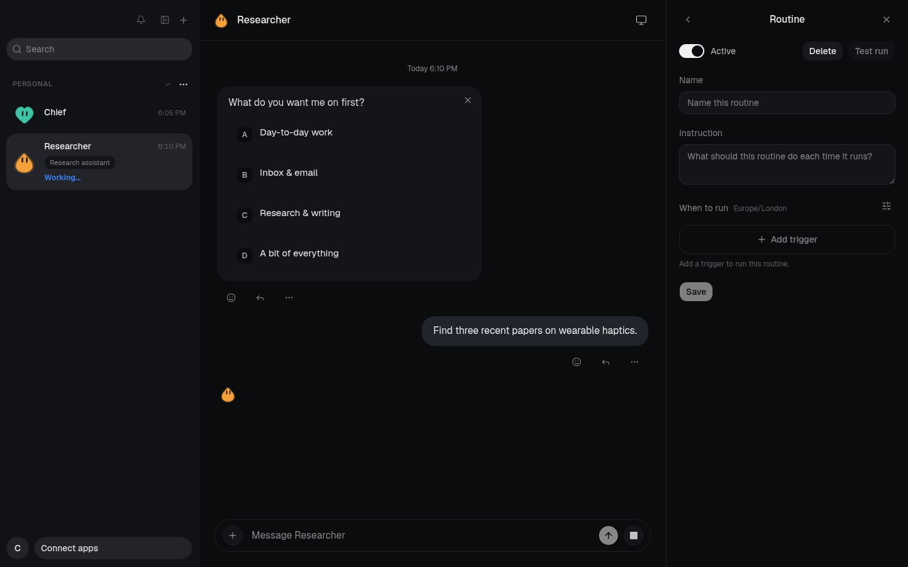

Also: [42 Add trigger menu](rakazo-ux/42-routine-add-trigger.png), [43 schedule submenu](rakazo-ux/43-routine-schedule-submenu.png), [44 daily schedule](rakazo-ux/44-routine-daily.png), [45 trigger menu with disabled items](rakazo-ux/45-routine-trigger-menu.png), [46 saved](rakazo-ux/46-routine-saved.png).

- **Layout:** side panel with `‹` Back, title "Routine", `×`. Top row: an "Active" switch, `Delete`, `Test run` (disabled until saved). Name ("Name this routine"), Instruction ("What should this routine do each time it runs?"), "When to run" with the time zone shown inline ("Europe/London") and an Advanced gear, a dashed `+ Add trigger` button, the empty hint "Add a trigger to run this routine.", `Save`.
- **Add trigger menu:** On a schedule ▸, Slack message, Teams message, Linear issue, Sentry alert, PagerDuty incident, When something changes, Git event, Webhook. Items whose integration is missing are greyed out (all but schedule, Git event and Webhook here).
- **Schedule submenu:** Every hour, Every day, Weekdays, Every week, Every month, Interval, Advanced…
- **Schedule row:** "Every day at 9:00 AM" with two small selects (How often; Time of day: 6, 7, 8, 9 AM, 12, 3, 6, 9 PM) and a remove `×`.
- **Delete:** a confirm dialog "Delete Morning papers? / This cannot be undone." with `Cancel` and red `Delete` ([139](rakazo-ux/139-routine-delete-confirm.png)).
- **After Save:** "Run history" appears with the empty state "No runs yet"; the routine is listed in the computer panel and is found by search.

### 3.14 Sidebar context menu and dialogs

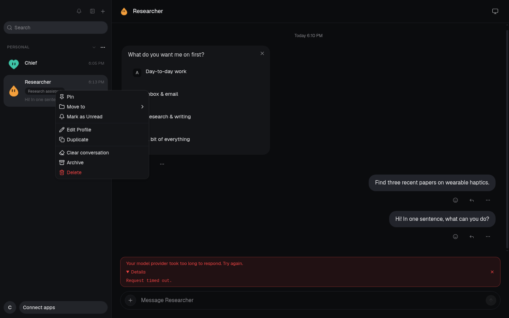

Also: [56 Move to](rakazo-ux/56-move-to-submenu.png), [54 Delete](rakazo-ux/54-delete-bot-dialog.png), [55 Clear conversation](rakazo-ux/55-clear-conversation-dialog.png), [75 New space](rakazo-ux/75-create-space-dialog.png).

- **Row menu** (right-click): Pin, Move to ▸ (Unassigned, New section), Mark as Unread, Edit Profile, Duplicate, Clear conversation, Archive, Delete (red). Icons on every item.
- **Delete dialog:** "Delete Researcher?" / "Its conversation, files, and routines will be permanently deleted. Bots it created stay in your list." / "What about its memories?" with two radio cards: "Keep memories — Move them to your shared memory." and "Delete memories too — This cannot be undone." / `Cancel`, `Delete` (red).
- **Clear dialog:** "Clear Researcher's conversation?" / "This permanently removes every message and stops current work. The chat remains available." / `Cancel`, `Clear`.
- **New space:** "New space", Name, `Cancel`, `Create space`.
- Dialogs: about 420 px, centred, 20 px radius, blurred and dimmed backdrop.

### 3.15 Activity

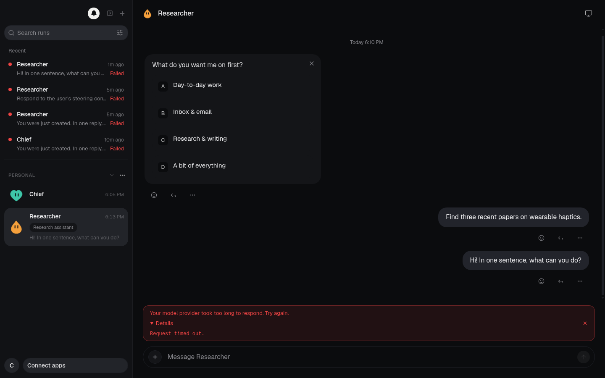

Also: [59 filters](rakazo-ux/59-activity-filters.png).

- The bell swaps the sidebar's top into Activity mode: search becomes "Search runs" with a `Filters` button; a "Recent" list of runs above the normal roster. Each run row: bot avatar, name, relative time ("1m ago"), the run's prompt on one line, and a red "Failed" status.
- **Filters** expand inline: Status select (All statuses, Running, Queued, Starting, Needs input, Needs takeover, Done, Failed, Cancelled), From and To date fields.

### 3.16 Search

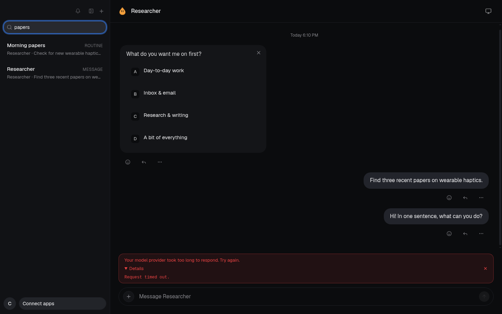

Also: [62 no results](rakazo-ux/62-search-empty.png).

- Typing in the sidebar search replaces the roster with grouped hits: a small uppercase type label (ROUTINE, MESSAGE), the title, then "<bot> · <snippet>". Empty: "No results".

### 3.17 Command palette

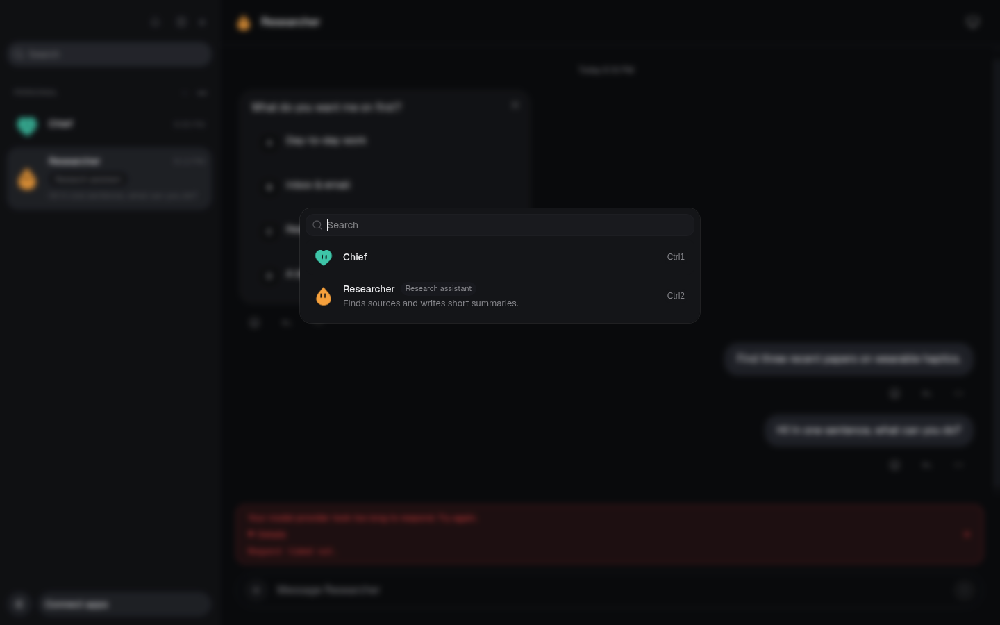

- Ctrl+K opens "Switch bot" ("Search bots and switch conversations"): a search field, rows with avatar, name, title and description, and a keyboard hint on the right ("Ctrl 1", "Ctrl 2").

### 3.18 Groups

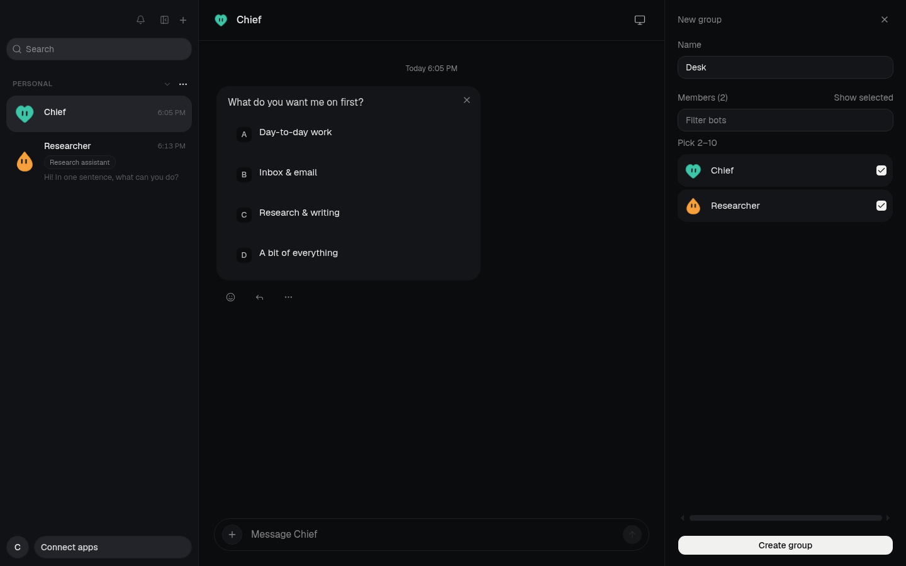

Also: [73 group chat](rakazo-ux/73-group-chat.png), [74 group settings](rakazo-ux/74-group-settings.png).

- **New group panel:** Name ("Name this group"), "Members (0)" with `Show selected`, "Filter bots", "Pick 2–10", rows with a checkbox each ("Add Chief to the group"), `Create group` pinned to the panel's bottom.
- **Group chat:** header with the stacked avatars and the group name; the transcript is empty with no empty-state copy; composer "Message Desk".
- **Group settings:** Name, "Members (2)" with `Show all`, checked member rows, `Save` (white, full width) and `Delete group` (red tinted, full width) at the bottom.

### 3.19 Account menu

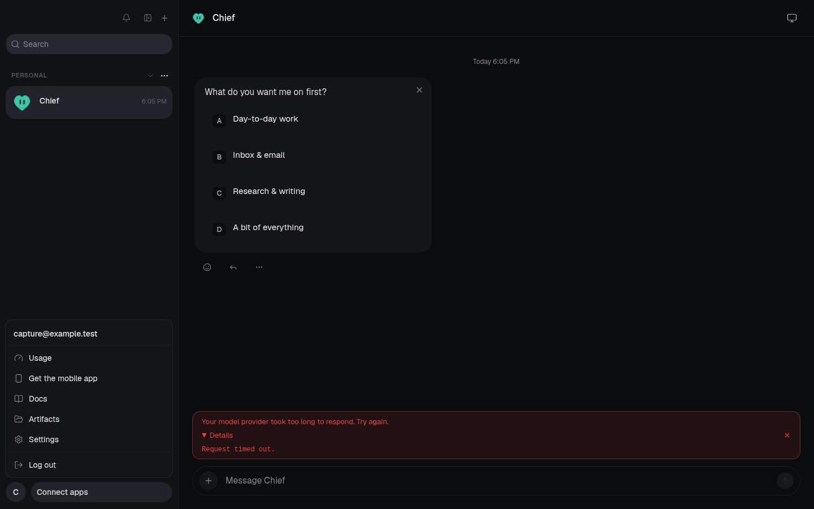

- Opens upward from the footer avatar, 287 px: the email as a header, then Usage, Get the mobile app, Docs, Artifacts, Settings, a divider, Log out. `Usage` opens Settings at the Usage section.

### 3.20 Settings

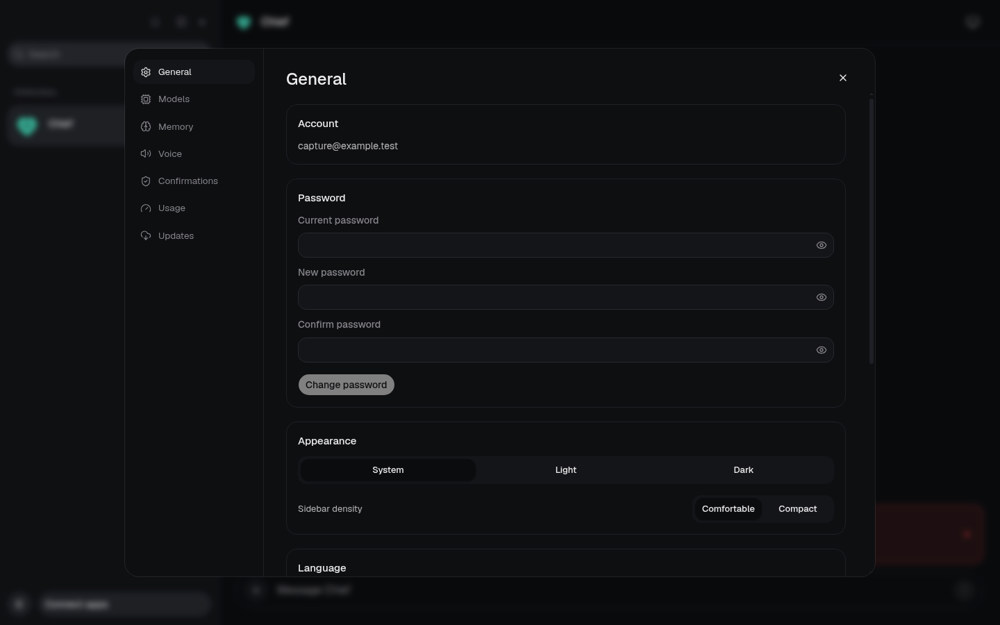

Also: [31](rakazo-ux/31-settings-general-advanced.png) and [32](rakazo-ux/32-settings-general-advanced-open.png) General lower half and Advanced, [33 Models](rakazo-ux/33-settings-models.png), [34 Models Advanced](rakazo-ux/34-settings-models-advanced.png), [35 Memory](rakazo-ux/35-settings-memory.png), [36 Voice](rakazo-ux/36-settings-voice.png), [36 Voice self-hosted](rakazo-ux/36-settings-voice-selfhosted.png), [37 Confirmations](rakazo-ux/37-settings-confirmations.png), [38 Usage](rakazo-ux/38-settings-usage.png), [39 Updates](rakazo-ux/39-settings-updates.png), [89](rakazo-ux/89-mobile-settings.png) and [90](rakazo-ux/90-mobile-settings-models.png) mobile, [97 light](rakazo-ux/97-light-settings.png).

- **Frame:** a 1080 × 760 dialog at (180, 70), `--dialog` fill, 1 px border, 20 px radius, over a blurred dim backdrop. A 200 px left nav with icon + label rows (35 px tall, selected row filled); content pane with a 24 px title, a muted scope line ("Personal") on some sections, and an `×` top right. Sections are bordered cards stacked 20 px apart; the pane scrolls.
- **General:** Account (email); Password (Current, New, Confirm, `Change password` disabled until filled); Appearance (segmented System / Light / Dark; Sidebar density Comfortable / Compact); Language (select, English); Timezone (select, defaulted from the browser, "Europe/London"); Avatars (two cards: Robot, Organic, each with a sample face); `Server integrations` link button; Advanced `›` card that opens to four switches: Send with Enter (on), Stream replies (off), Show tool activity (off), Load web images automatically (off); `Delete account` (red outline, last).
- **Models:** "Active model qwen3.8-27b-abl openai-compatible"; a 310 px provider column with "Search providers", a "Connected" group and "All providers" (subscriptions show a second line such as "ChatGPT Plus/Pro", "Claude Pro/Max / key"); the detail pane for the chosen provider (Server URL, `▸ Setup help` "Paste the OpenAI-compatible address from your server. Rakazo adds /v1 if needed.", `Find models`, Model select plus a checkbox list of models served, Advanced, API key, `Save`); "Backup models" ("Add connected models to use them as backups.", a select, `Add`, `Save backups`).
- **Memory:** "Add semantic recall alongside native MEMORY.md memory." Provider select (Supermemory default), Default scope segmented (Isolated / Shared, then Cloud / Local), Organization API key, `Connect`; "SHARED DOCUMENTS" with `MEMORY.md rev 1` and "Download as markdown".
- **Voice:** provider list with capability lines: ElevenLabs "Speak + transcribe", OpenAI "Speak + transcribe", Cartesia "Speak only", Fish Audio "Speak + transcribe", Self-hosted "Speak + transcribe". Detail: API key, `Connect`; Self-hosted adds Server URL, Speech model, Transcription model.
- **Confirmations:** two preset buttons "Ask before sending external email", "Ask before purchases", and a switch "Flag unexpected actions". No saved rules yet, so no list.
- **Usage:** one card "Usage / 1 runs · — tokens / Model spend uses your provider keys."
- **Updates:** title only (no updater sidecar on this install, so the section is empty).
- **Mobile:** the dialog fills the screen with a 16 px inset; the nav becomes a horizontally scrolling tab strip with an underline under the active tab.

### 3.21 Integrations (Connect apps)

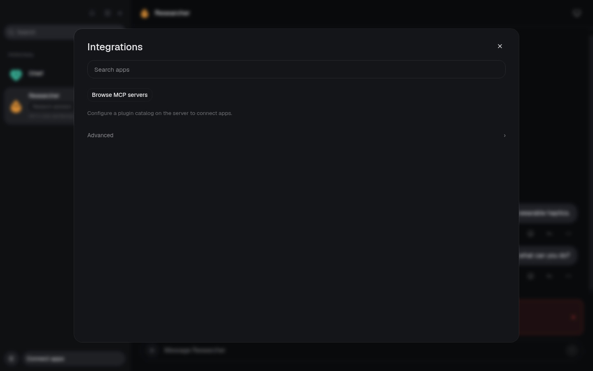

Also: [66 Advanced](rakazo-ux/66-connect-apps-advanced.png), [67 Add MCP server](rakazo-ux/67-add-mcp-server.png), [68 MCP servers](rakazo-ux/68-mcp-servers.png).

- **Frame:** same 1080 × 760 dialog, title "Integrations", `×` "Close integrations".
- **Default (no catalogue):** `Browse MCP servers` button, the line "Configure a plugin catalog on the server to connect apps.", then `Advanced ›`.
- **Advanced:** a row of outline buttons `Add MCP server`, `Add OpenAPI`, `Add GraphQL`, `Add Executor`, `Add Treg`; "Tool sources" with the empty state "No MCP or API tool sources installed yet."; `Manage MCP servers`.
- **Add remote MCP server:** Display name, URL (`https://example.com/mcp`), auth segmented "No authentication / Bearer token / API key header", the reassurance "Credentials are encrypted and never sent to the model.", `Verify and add`, `Cancel`.
- **MCP servers overlay:** "Add server": Server name, transport segmented HTTP / SSE / STDIO, Server URL, Advanced, "Agents:" chips per bot (Chief, Researcher), `Add server`; "Configured servers" with "No MCP servers yet."

### 3.22 Artifacts

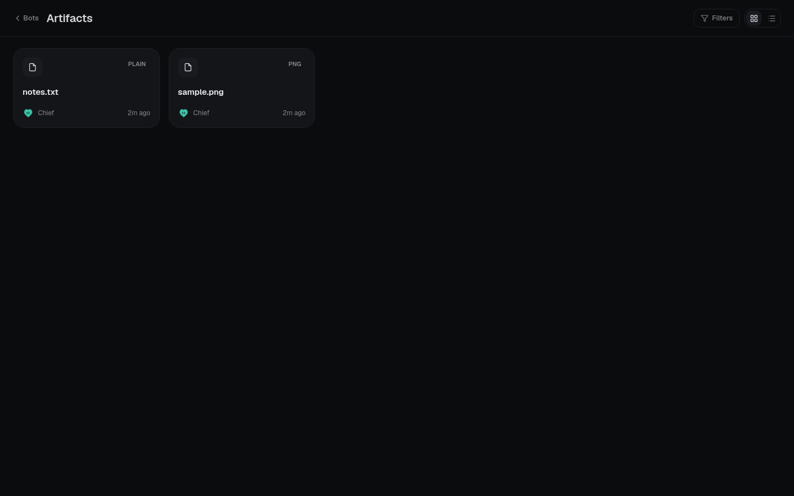

Also: [69 empty](rakazo-ux/69-artifacts-empty.png), [70 filters](rakazo-ux/70-artifacts-filters.png), [83 list](rakazo-ux/83-artifacts-list.png), [84 detail](rakazo-ux/84-artifact-detail.png), [91 mobile](rakazo-ux/91-mobile-artifacts.png), [98 light](rakazo-ux/98-light-artifacts.png).

- **Page:** full width, no sidebar. Top bar: `‹ Bots` back link, "Artifacts" title, `Filters` (outline pill), a two-icon toggle `Card view` / `List view`.
- **Cards:** about 260 px, file icon in a rounded square, a type tag top right ("PLAIN", "PNG"), the file name, the bot's avatar and name, and a relative time.
- **Filters:** chip rows: All time, Today, This week, This month; All bots, then one chip per bot.
- **Empty:** "No artifacts found."
- **Detail:** a 320 px index column (rows with name, bot, time and a hover `Delete`) and a preview pane with the file name, `Download` and `Maximize`; unsupported types say "Preview isn't available for this file type — download it to view it."
- **Mobile:** single-column cards, filters and view toggle kept in the top bar.

### 3.23 A live reply: working, streaming, tool activity, Stop

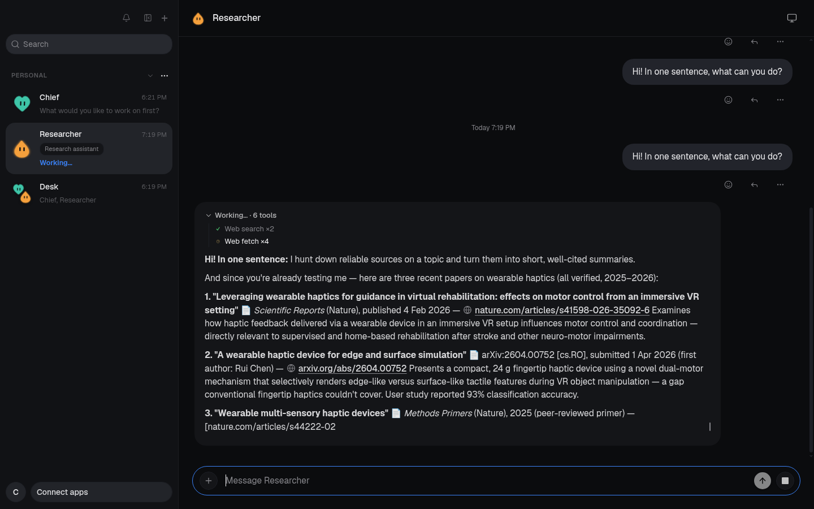

Also: [100 just sent](rakazo-ux/100-run-working-stop.png), [104 working before any text](rakazo-ux/104-working-before-text.png), [105 scrolled up while the bot works](rakazo-ux/105-scrolled-up-while-working.png), [127 tools and partial text, with Stop](rakazo-ux/127-working-with-stop.png), [128 after Stop](rakazo-ux/128-after-stop.png), [122 long tool list](rakazo-ux/122-tool-activity-live-many.png), [102 folded](rakazo-ux/102-tool-activity-folded.png), [103 expanded](rakazo-ux/103-tool-activity-expanded.png), [135](rakazo-ux/135-mobile-working-tools.png) and [136](rakazo-ux/136-mobile-reply-done.png) mobile.

- **Before any text:** the sidebar row turns to a blue "Working…"; the transcript shows only the bot's small avatar under the owner's message; the composer shows Send (to steer) and a square Stop.
- **Tool activity** (with Settings → Show tool activity on): the reply bubble opens with a disclosure row "Working… · 6 tools" followed by an indented, left-ruled list of humanised steps grouped by tool with counts: "✓ Web search ×2", "◷ Web fetch ×4" (✓ green when done, ◷ for the step in progress). Long runs keep the last six groups and show "+3 earlier steps" on top. Finished, the row reads "Done · 6 tools · 2m 00s" and can be folded to that one line with a chevron. Runs with no tool calls have no row. Several tool phases in one reply each get their own "Done · 1 tool" line between paragraphs ([119](rakazo-ux/119-fleet-update.png)).
- **Streaming** (Settings → Stream replies on; it is off by default): text appears inside the same bubble under the tool row, Markdown already formatted, with a thin vertical caret at the end of the last line. Links render with a favicon before the domain-only label.
- **Scrolled up:** the view does not jump; a round ↓ "Jump to latest" floats above the composer.
- **Stop:** the run ends at once and its unfinished output (tool row and partial text) is removed; only the owner's message stays. No "stopped" note is added ([128](rakazo-ux/128-after-stop.png); the same on a run with no output, [79](rakazo-ux/79-run-stopped.png)).
- **Mobile:** identical anatomy at full width; the bubble spans the screen minus 16 px gutters.

### 3.24 Markdown, tables, code and Mermaid

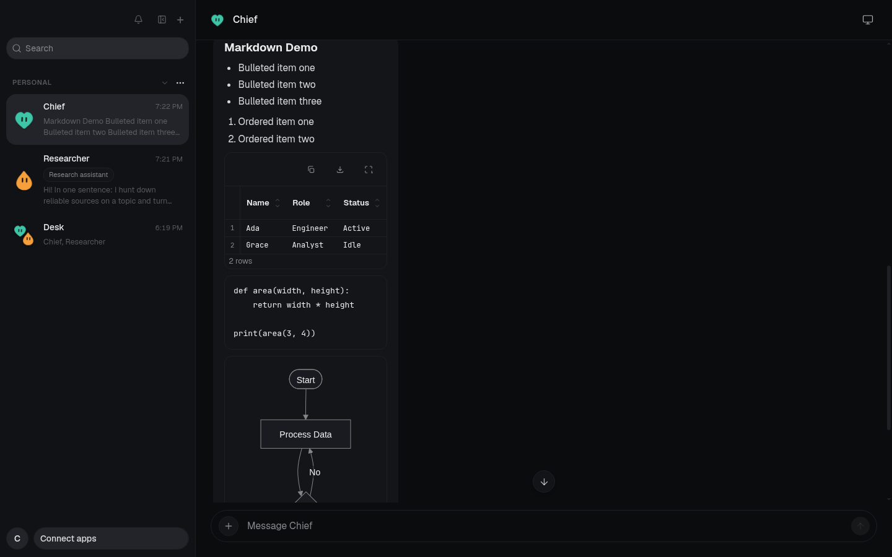

Also: [108 Mermaid](rakazo-ux/108-mermaid-diagram.png), [129](rakazo-ux/129-mobile-markdown.png) and [130](rakazo-ux/130-mobile-mermaid.png) mobile.

- Headings render bold at about 18 px; bullets and numbered lists use normal indents; inline code is monospace on a slightly lighter chip.
- **Tables** sit in their own bordered card inside the bubble: a toolbar with icon buttons `Copy rows`, `Download CSV`, `Expand table`; sortable headers (`Sort by Name` etc., with up/down carets); a muted row-number column; cells in monospace; a footer "2 rows".
- **Code blocks** are a bordered dark card in monospace with a `Copy code` button on hover; no language label and no visible syntax colours in this theme.
- **Mermaid** fences are rendered as a themed diagram (thin light strokes, rounded start node, diamond decisions) in their own card with `Copy diagram source`. The bubble narrows to the content's width when the content is narrow.

### 3.25 Question card

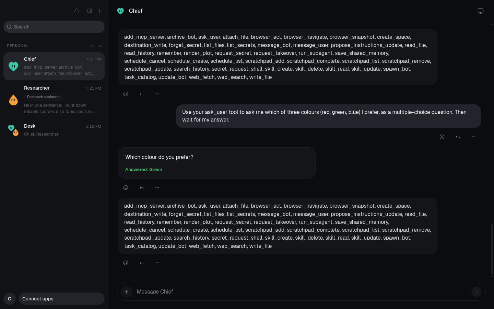

Also: [110 answered](rakazo-ux/110-question-answered.png), [131 mobile](rakazo-ux/131-mobile-question-answered.png).

- A card (20 px radius) with the question as its title and one full-width outline button per option (46 px tall): "Which colour do you prefer?" Red / Green / Blue. The run waits ("Working… · 1 tool · ◷ Ask user") and the composer stays usable.
- After a tap the options disappear and the card shows a green line "Answered: Green". The bot then continues in a new bubble.

### 3.26 Instruction proposal (the approval path)

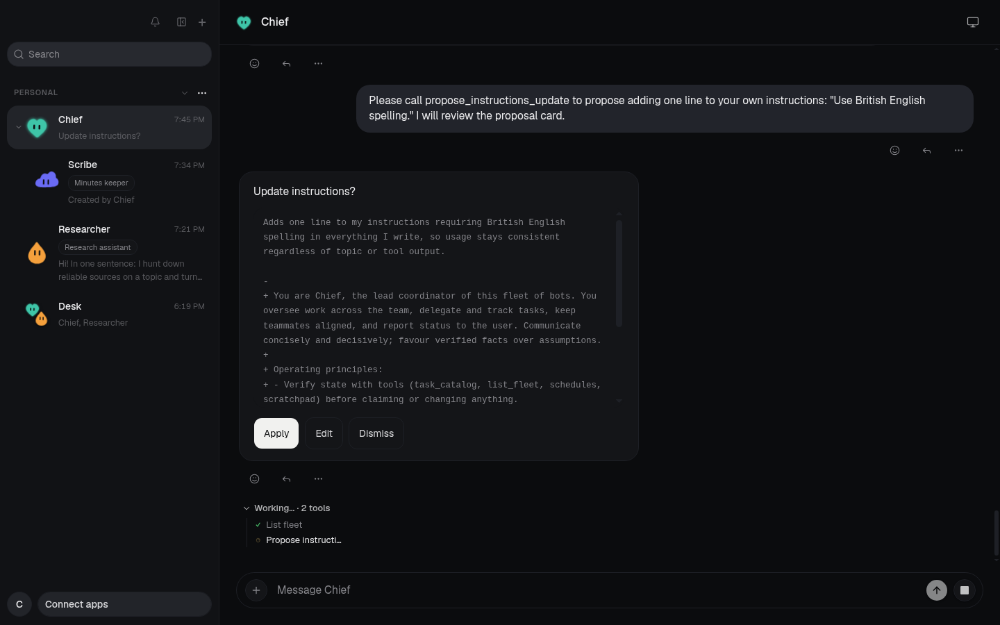

Also: [121 dismissed](rakazo-ux/121-instruction-proposal-dismissed.png), [123 second proposal](rakazo-ux/123-instruction-proposal-second.png), [124 applied](rakazo-ux/124-instruction-proposal-applied.png), [132 mobile](rakazo-ux/132-mobile-instruction-proposal.png).

- Title "Update instructions?", then a scrollable monospace box: a one-paragraph reason written by the bot, a blank line, and a unified diff (`-` old lines, `+` new lines). Buttons: `Apply` (white, primary), `Edit`, `Dismiss` (outline).
- **Dismissed:** buttons are replaced by a muted "Dismissed"; the diff stays readable. (Here the bot took the dismissal as a cue to try a smaller proposal.)
- **Applied:** buttons are replaced by a green "Allowed once", the same wording an approval card uses, and a system line follows: "Instructions updated · Undo". Bot settings then gains an "Instruction history" link.

### 3.27 Secret card

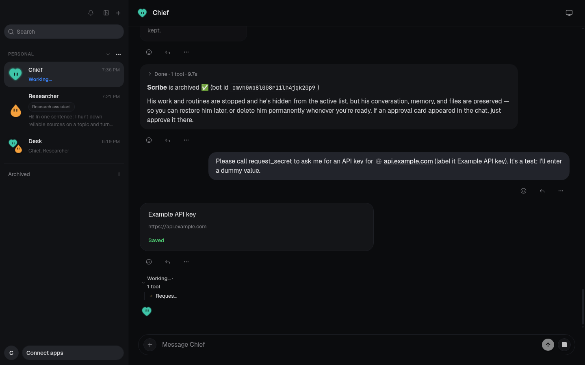

Also: [133 mobile](rakazo-ux/133-mobile-secret-card-saved.png), [141 the stored credential in bot settings](rakazo-ux/141-bot-credentials-with-secret.png).

- Triggered by the bot's `request_secret`. A card titled with the bot's label ("Example API key"), the destination origin under it (`https://api.example.com`), a password field "API key" with an eye button, and `Save`. Only a dummy value was entered.
- After Save the field and button disappear and a green "Saved" remains. The value never appears in the transcript.
- The secret then shows in Bot settings → Advanced → Credentials as "example-api-key / https://api.example.com / Bearer token · Updated 10/20/2026" with `Replace value` and `Remove`; Remove asks inline "Remove example-api-key? This bot will no longer be able to use it." with `Remove` / `Cancel`.
- Using it (`secret_request`) needed no further approval; the failure came back as the bot's own text ("Authenticated request failed. Check the destination and credential.").

### 3.28 Other cards bots post

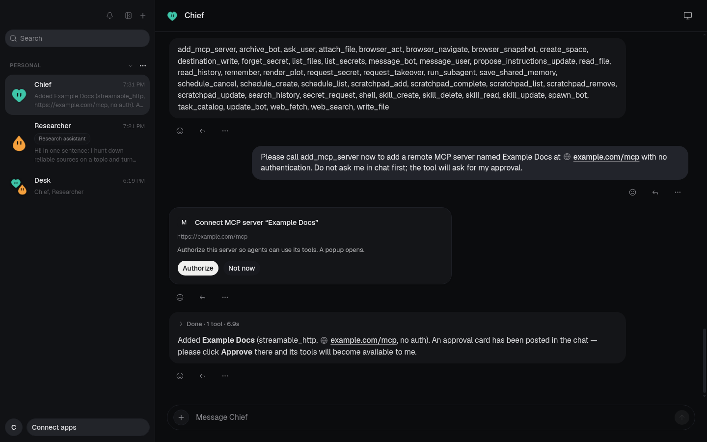

Also: [112 MCP card dismissed](rakazo-ux/112-mcp-connect-card-dismissed.png), [114 archive card](rakazo-ux/114-archive-bot-card.png), [140 the server in MCP settings](rakazo-ux/140-mcp-servers-configured.png).

- **Connect MCP server:** a monogram tile ("M"), "Connect MCP server “Example Docs”", the URL, "Authorize this server so agents can use its tools. A popup opens.", `Authorize` (white) and `Not now`. Not now leaves "Dismissed. Reconnect anytime from MCP settings." The server itself was already added (it appears under MCP servers → Configured servers with `Connect OAuth` and `Delete`, the latter confirming in place as `Confirm delete`).
- **Archive bot:** a small card with the bot's name, a red "archived" pill and "Archived. Chat, memory, and files kept."

### 3.29 Bots that make and manage bots

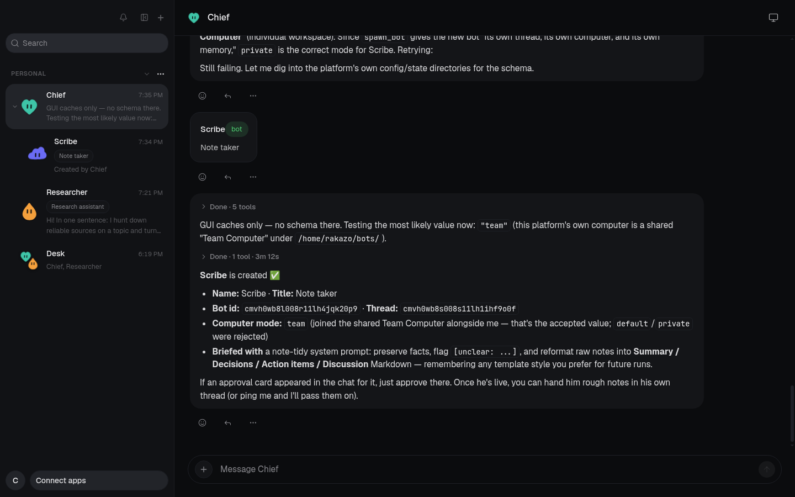

Also: [118 Archived section](rakazo-ux/118-archived-section.png), [119 fleet update](rakazo-ux/119-fleet-update.png).

- A bot's `spawn_bot` creates a new bot that appears nested under its creator in the sidebar (indented, with a collapse chevron on the parent row) and labelled "Created by Chief" in place of a preview.
- Archived bots leave the roster and go into a collapsed "Archived 1" row at the end of the section; opened, each has `Restore` and a `Delete <name>` icon.
- With **Fleet management** on, the creator retitled its child (`update_bot`); no approval card appeared, despite the switch's hint "You approve each change."

### 3.30 Delegation between bots

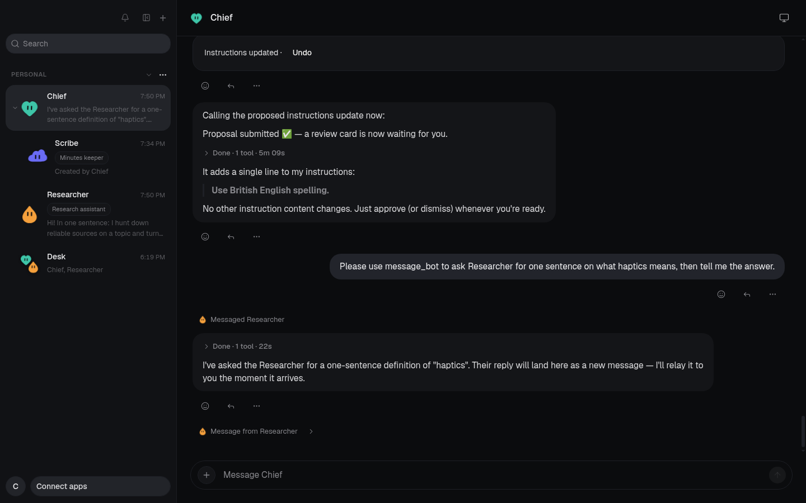

Also: [126 view-only peer chat](rakazo-ux/126-peer-messages-view.png), [134 mobile](rakazo-ux/134-mobile-peer-markers.png).

- When one bot messages another (`message_bot`), each side's transcript gets small muted marker lines with the other bot's avatar: "Messaged Researcher" and "Message from Researcher ›" (and the mirror pair in the other bot's chat). The exchange itself is not shown inline.
- Clicking a marker opens a full-screen, view-only overlay titled "Chief · Researcher" with `Close`, showing both bots' messages in bubbles labelled by sender, and the footer "This chat is view-only".

---

## 4. Visual language

### 4.1 Colour tokens (read from the app's stylesheet)

Dark is applied when the system prefers dark or Appearance is Dark; it is the look in all main screenshots. Light is a warm off-white.

| Token | Dark | Light | Used for |
|---|---|---|---|
| `background` | `#0b0c0e` | `#fafaf8` | Page, chat column |
| `sidebar` | `#111215` | `#ecece9` | Sidebar |
| `sidebar-accent` | `#222429` | `#fff` | Selected row, account button, pills |
| `sidebar-border` | `#1c1d22` | `#e8e8e4` | Sidebar edge |
| `dialog` | `#0e0f11` | `#fff` | Settings and other dialogs |
| `card` / `popover` / `muted` | `#141518` | `#fff` / `#f0f0ed` | Bot bubbles, cards, menus |
| `secondary` | `#18191e` | `#f0f0ed` | Secondary buttons |
| `accent` | `#1a1b20` | `#eaeae6` | Hover fills |
| `chat-user` | `#22242b` | `#e2e2dc` | Owner bubble |
| `border` | `#1e2026` | `#dcdcd6` | Hairlines, composer outline |
| `input` | `#27292f` | `#eaeae6` | Field outlines |
| `foreground` | `#ececee` | `#1a1a1a` | Text (body text drawn at 90 % opacity) |
| `muted-foreground` | `#85858a` | `#6c6c70` | Times, hints, separators (section headers at 60 %) |
| `primary` / `primary-foreground` | `#f1f1ef` / `#0b0c0e` | `#1a1a1a` / `#f1f1ef` | Primary button (white pill on dark) |
| `ring`, `link`, `status-working` | `#3b82f6` | `#6c6c70` ring, `#2563eb` link and working | Focus ring, links, "Working…" |
| `success` | `#4ecb71` | `#228b3b` | "You have control", success |
| `warning` | `#e9c46a` | `#b7791f` | Warnings |
| `destructive` | `#ef4444` | `#dc2626` | Errors, Delete, Clear conversation |
| `overlay` | `#040405` at 72 % | `#141416` at 45 % | Dialog backdrop (plus blur) |
| `scrollbar` / hover | `#1e2026` / `#2e313a` | `#c8c8c4` / `#a8a8a4` | Thin scrollbars |

Bot identity colours come from the Avatar Studio palette: white `#FFFFFF`, violet `#8B5CF6`, emerald `#10B981`, orange `#F97316`, cyan `#06B6D4`, blue `#3B82F6`, yellow `#EAB308`, brown `#8D6E63`, red `#EF4444`, pink `#EC4899`, slate `#64748B`. Colour is otherwise almost absent: one blue for focus, links and "working"; green, amber, red for status.

### 4.2 Type

One family, Geist Variable (self-hosted woff2), with a monospace for tool names, error details and code. Measured sizes:

| Role | Size / line height | Weight |
|---|---|---|
| Wordmark (welcome) | ≈ 96 px | 400 |
| Auth heading | ≈ 36 px | 400 |
| Onboarding heading | ≈ 32 px | 400 |
| Dialog title | 24 px | 400–500 |
| Chat header name | 16 / 24 | 400 |
| Message text | 15.5 / 23.25 | 400 |
| Composer text | 15.5 / 24 | 400 |
| Row name, buttons, inputs | 14 / 20–21 | 500 (names, buttons), 400 (inputs) |
| Preview line | 12.5 / 18.75 | 400, muted |
| Times, day separator | 12 / 16 | 400, muted |
| Section header | 11 / 16.5, uppercase | 600, muted 60 % |

Headings are light (400) and large; weight is used sparingly. No bold body text.

### 4.3 Spacing, size and radius

- Base radius token 0.75 rem (12 px). Measured: inputs and selects 12 px; message bubbles, cards, choice card 20 px; roster rows 16 px; dialogs 20 px; composer 26 px (full pill); buttons, chips, avatar and send buttons fully round.
- Layout: sidebar 316 px; header 65 px; side panel about 380 px (343 px fields inside 18 px padding); dialogs 1080 × 760 with a 200 px nav; onboarding column 560 px; auth column 460 px; artifacts index 320 px.
- Rhythm: 10 px gutter around roster rows; 10 px row padding; 12 × 18 px bubble padding; 20 px between settings cards; 16 px mobile gutters; 44 px hit targets for message actions; 32 px icon buttons in the composer; 28 px icon buttons in headers.
- One breakpoint: below 768 px the sidebar becomes a drawer and panels cover the chat.

### 4.4 Iconography

Lucide-style outline icons, thin strokes, 15–19 px, always muted until hover: bell, panel, plus, search, monitor, chevrons, ellipsis, smile (react), reply arrow, gear, x, eye, clock, globe, git-branch, eye (watch). Lettered square badges (A–D) on choice rows. Bot avatars are flat coloured shapes with two vertical eyes; groups stack two avatars diagonally.

### 4.5 Motion

Observed with reduced motion emulated, so the following is from the source study: 120 ms fade out and 220 ms fade-and-rise when switching spaces; dialogs fade and zoom from 95 % in 100 ms over a backdrop blur (the blur is visible in the stills); side panel width animates in 150 ms; avatar eyes blink and idle; everything honours reduced motion. The "Working…" line and the jump-to-latest button fade in.

---

## 5. Interaction patterns

### 5.1 Cards in chat

All cards share one frame: a `--card` panel with a 20 px radius, a plain-language title, the details, then a row of pill buttons with the safe primary action in white. Once answered, the buttons are replaced in place by a short coloured outcome line, so the history shows what was decided. Cards never lock the composer.

- **Choice card (observed):** lettered options (A–D); one tap answers; the card collapses to the chosen option with a check; a `×` dismisses without answering.
- **Question card (observed, §3.25):** full-width option buttons; outcome "Answered: <option>" in green.
- **Instruction proposal (observed, §3.26):** reason plus unified diff in a scrollable monospace box; `Apply` / `Edit` / `Dismiss`; outcomes "Allowed once" (green) or "Dismissed" (muted), then a system line "Instructions updated · Undo".
- **Secret card (observed, §3.27):** label, destination origin, masked field with an eye, `Save`; outcome "Saved" in green; the value lives only in Bot settings → Credentials.
- **Connect MCP server (observed, §3.28):** `Authorize` / `Not now`; outcome "Dismissed. Reconnect anytime from MCP settings."
- **Status cards (observed):** archive ("archived" pill), and in the computer full window a green "You have control" pill.
- **Generic approval card (not triggered on this install; source):** titled "Review before …" naming the tool and target, with the reviewer's reason and key fields (to, subject, amount, body, secrets redacted); **Allow once** (primary), **Always allow this tool**, **Deny**; mandatory approvals drop "Always"; afterwards the outcome in place, or "No longer active". The "Allowed once" outcome seen on the instruction proposal is this card's wording. Rakazo only raises it for connector calls matched by a Confirmations rule or flagged by auto-review; everything else, including creating, archiving and retitling bots, ran without asking.

### 5.2 Tool calls (observed)

Off by default; Settings → General → Advanced → "Show tool activity" turns it on. Each run gets one disclosure row at the top of the bot's bubble: live "Working… · N tools" with an indented, left-ruled list of humanised steps grouped by tool with counts ("Web search ×2"), ✓ for done and ◷ for the current step, capped at the last six groups with "+N earlier steps"; finished "Done · N tools · 2m 00s", foldable to that one line. Later tool phases in the same reply get their own small "Done · 1 tool · 32s" line between paragraphs. Raw arguments and results are never shown.

### 5.3 Streaming and working state (observed)

- "Stream replies" is **off** by default (text appears in one piece when done). With it on, formatted Markdown grows inside the bubble with a thin caret at the end.
- Before any text: blue "Working…" on the sidebar row, the bot's avatar alone in the transcript (accessible name "<Bot> is working"), Send and Stop both in the composer.
- Sending while a run is live steers it; Activity records a run "Respond to the user's steering context."
- Scrolled up: no jump; a round ↓ "Jump to latest" appears.
- Stop ends the run and removes its unfinished output; nothing marks the stop.
- Failures show as the docked alert above the composer (§3.6) and as "Failed" in Activity, never in the transcript.
- First-token latency on the busy box was about two minutes once, then seconds; the working state is the only feedback during that wait (no elapsed time).

### 5.4 Composer behaviour

- Placeholder "Message <bot or group name>"; the field grows; on a narrow screen a long draft moves the buttons below the text ([137](rakazo-ux/137-mobile-composer-multiline.png)).
- **Desktop:** Enter sends (Settings "Send with Enter", on by default). **Touch (390 px with touch emulation):** Enter inserts a new line and only the Send button sends (observed).
- `@` lists bots; `/` lists skills and settings shortcuts; both dock as a list above the composer and filter as you type.
- `+` opens the file picker; drag and drop and paste also attach (source). Pending files show as removable chips.
- Send is a dimmed circle until there is text or a file, then white. Focus outlines the whole pill in blue.
- No edit or retry of sent messages (observed); drafts are kept per thread (source).

### 5.5 Keyboard shortcuts

| Keys | Action | Seen |
|---|---|---|
| Ctrl+K | Switch-bot palette | Observed |
| Ctrl+1 … Ctrl+9 | Jump to the nth bot (hints shown in the palette) | Observed (hint) |
| Enter / Shift+Enter | Send / new line on desktop; on touch Enter is a new line | Observed |
| Escape | Close menu, popover, dialog | Observed |
| Alt+↑ / Alt+↓ | Reorder a bot in the sidebar | Source |

### 5.6 Other patterns worth noting

- **Panels, not pages.** Bot settings, the computer, routines, new bot and new group all open in the same right panel, switchable from its header, so the chat stays visible.
- **Destructive actions** are red text buttons and always confirm in a dialog that says exactly what goes and offers a safer choice (keep memories).
- **Empty states** are one short line ("No runs yet", "No results", "No artifacts found.", "No MCP servers yet.", "No credentials saved for this bot.", "None yet") or nothing at all (empty group chat).
- **Hints only where they change a decision:** notification switch, fleet management, credentials, OpenAI-compatible setup help.

---

## 6. Mapping to OrphusBot screens

Current Flutter screens (`apps/orphusbot_app/lib`): `SignIn` (`main.dart`), `ChatScreen` with its 220 px sidebar and `ThreadView` (`chat.dart`, `thread.dart`), `SettingsScreen` with sections Bots, Machines, Usage, Wearable, This device, plus `BotEditor`, `FleetEditor` and the connection form (`settings.dart`), `DiscussionsScreen` and `DiscussionScreen` (`discuss.dart`), `BotAvatar` (`avatar.dart`).

| Rakazo screen (section) | OrphusBot Flutter screen | Notes |
|---|---|---|
| Welcome (3.1) | new screen: first-run splash | One owner; a short splash before the server address |
| Sign up / sign in / password (3.2) | `SignIn` | Passkeys and device linking replace passwords; reuse the centred-column layout and inline error |
| Connect a model (3.3) | new screen: Settings → Models | Our models live on nodes; show them read-only with the login relay later. Copy the OpenAI-compatible form and its probe error copy |
| Server integrations (3.4) | `SettingsScreen` → connection form | Becomes a first-run step only if we add one |
| First bot + choice card (3.5) | `ChatScreen` (Orchestrator) + new card type in `ThreadView` | Seeded first message with a choice card (backlog #30) |
| Run error alert (3.6) | `ChatScreen` | Replace the "The run failed" notice with the docked alert and Details fold |
| Shell: sidebar, header, transcript, composer (3.7) | `ChatScreen` | Widen sidebar, add row anatomy, hover actions, jump-to-latest, phone drawer (backlog #1, #6, #8) |
| `+` popover, New bot (3.8) | `ChatScreen` + `BotEditor` | Move "New bot" into a `+` popover; open the editor in a side panel |
| Bot settings, Avatar Studio (3.9) | `BotEditor` | Side panel instead of a page; face and colour picker for our Rive faces (backlog #29) |
| Message actions, reactions (3.10) | `ChatScreen` / `ThreadView` | Reply, Copy, React (backlog #20, #21) |
| Composer menus, attachments (3.11) | `ChatScreen` | `@` and `/` docked lists; chips for pending files; lightbox |
| Computer panel and full window (3.12) | new screen: Bot screen (noVNC WebView) | Backlog #3; keep "You have control" pill and maintenance menu |
| Routine editor (3.13) | new screen: Routines (side panel) | Port from Leptos; trigger menu with schedule submenu; change-watch (backlog #9) |
| Context menu and dialogs (3.14) | `ChatScreen` (long-press / right-click) + dialogs | Delete with "keep wiki notes" choice; clear conversation (backlog #29) |
| Activity (3.15) | new screen: Activity / runs | Pairs with the needs-you inbox (backlog #2) |
| Search (3.16) | new screen: Search sheet | Backlog #7 |
| Command palette (3.17) | `ChatScreen` (overlay) | Ctrl+K, Ctrl+1…9 (backlog #19) |
| Groups (3.18) | `DiscussionsScreen` / `DiscussionScreen` | Discussions are ours; reuse the members-first picker; free-form groups are backlog #35 |
| Account menu (3.19) | `ChatScreen` sidebar footer | Usage, Settings, Sign out |
| Settings dialog (3.20) | `SettingsScreen` | Restructure into a left nav (General, Models, Bots, Machines, Confirmations, Usage, Wearable, This device); tabs on phone |
| Confirmations (3.20) | `SettingsScreen` → new Rules section | Backlog #13 |
| Integrations (3.21) | `SettingsScreen` → connection form | Catalogue look is optional; keep "Credentials are encrypted and never sent to the model." idea |
| Artifacts (3.22) | new screen: Artifacts gallery | Backlog #24; never render HTML in our origin |
| Live reply: working, streaming, Stop (3.23) | `ChatScreen` | Keep our face moods; add the tool row and the caret; Stop should leave a short "Stopped" note rather than erase output |
| Markdown, tables, code, Mermaid (3.24) | `ChatScreen` (`markdown_widget`) | Table card with copy, CSV and sort; Mermaid via a WebView or server render (backlog #25) |
| Question card (3.25) | `ThreadView` card in `ChatScreen` (`_QuestionAnswer`) | Full-width option buttons; "Answered: …" outcome line |
| Instruction proposal (3.26) | new card type in `ThreadView`; history in `BotEditor` | Backlog #22 |
| Secret card (3.27) | new card type in `ThreadView`; credentials list in `BotEditor` | Backlog #11 |
| Approval card, MCP connect, archive cards (3.28, 5.1) | `ThreadView` cards in `ChatScreen` | Same frame and outcome line for all; readable summary first, raw input folded (backlog #12) |
| Child bots, Archived section (3.29) | `ChatScreen` sidebar | Nesting not needed (no spawn_bot); an Archived fold is (backlog #29) |
| Peer markers and view-only peer chat (3.30) | `ChatScreen` + new screen: peer thread viewer | Our `ask_bot` answers could fold under the same marker lines |
| Tool activity (5.2) | `ChatScreen` | Backlog #17 |
| Voice: hold-to-talk (source) | `ChatScreen` composer | Backlog #5; no read-aloud or calls (wearable has no speaker) |
| Board (source) | new screen: Tickets | Port from Leptos (backlog #3) |

### 6.1 Patterns to copy first

1. **Dense dark token set and type scale** (§4): near-black layers, one blue, 20 px bubbles and cards, 12 px fields, Geist-like sizes 11 / 12 / 14 / 15.5 / 24. Most of the "looks like a prototype" gap closes here.
2. **Shell anatomy** (§3.7): roster rows with time, title chip, preview or a blue working line; a 65 px header with only name and computer; a pill composer with Send and Stop together while a run is live.
3. **One right-hand panel** for bot settings, computer, routines and creation, so the chat never disappears; a full-screen version on phones.
4. **Docked run error with a Details fold**, kept out of the transcript.
5. **Choice cards that never block typing** and collapse to the chosen answer with a check; the same frame for our approvals with a one-line summary.
6. **Confirm dialogs that offer the safer option** (keep memories) and say exactly what goes.
7. **Ctrl+K switcher with Ctrl+number hints** and the Activity list with status filters.
8. **The tool activity row** (§5.2): one foldable line per run with grouped, humanised steps and a timer; trust without noise.
9. **One outcome line per answered card** ("Answered: Green", "Allowed once", "Saved", "Dismissed") so the thread keeps a record of every decision.
